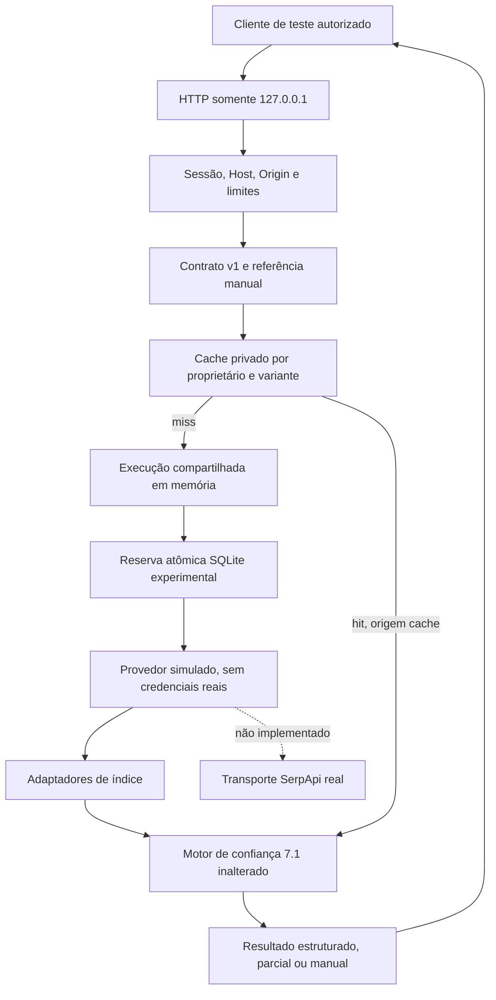

# Fase 7.2 — serviço intermediário local, segurança e adaptadores

Implementação e pesquisa em **21/11/2026**. Base conferida limpa/sincronizada: `0e694a84f243a4e3a15741ff0b1647e02376498c`, branch `feature/android-preview-splash`. PR #8 mantido aberto/em rascunho. Protótipo em [experiments/search-gateway](../experiments/search-gateway/README.md), sem integração ao Wish ou implantação externa.

## 1. Resumo executivo

Implementado serviço HTTP de loopback com sessões experimentais, contratos v1, validação limitada, cache privado persistente, compartilhamento de pesquisas simultâneas, orçamento transacional e provedor **exclusivamente simulado**. Adaptadores Search/Shopping/Immersive normalizam fixtures e reutilizam o motor 7.1 sem alterar seus critérios.

**Zero consultas SerpApi/Account API, zero créditos reais, zero EAS Build e zero serviços pagos nesta fase.** A chave real não foi lida ou utilizada. Os saldos SerpApi236 e EAS10 são históricos informados, não reconfirmados. Pesquisa de hospedagem usou somente páginas públicas oficiais; testes bloquearam rede externa e permitiram apenas loopback literal.

Pronto para experimentar o contrato e os controles localmente; **não pronto para publicação como serviço de produção**. Não há mecanismo real de pesquisa habilitado, autenticação mobile completa ou garantia de custo futuro imutável. Nenhuma oferta indexada/simulada recebe selo de preço confirmado diretamente na loja.

## 2. Componentes e fronteiras



| Módulo | Responsabilidade implementada |
| --- | --- |
| `contracts.ts` | Operações/erros/respostas v1, interface de provedor simulado e snapshot fictício de orçamento. |
| `validation.ts` | Dados planos limitados, referência com procedência manual, identidade para comparar, URLs, fingerprint e redação de segredos conhecidos. |
| `store.ts` | SQLite próprio para sessões/hash, orçamento, reservas, rate limit e cache; transações `BEGIN IMMEDIATE`, schema/application ID independentes. |
| `provider.ts`, `fixtures.ts` | Provedor simulado; fixtures de formato reconstruídas/sintéticas; descritor futuro SerpApi desabilitado e sem função de envio/chave. |
| `adapters.ts` | Mapeamento explícito de três formatos, procedência indexada, moeda/parcela/total/identificadores e marcação de cache. |
| `gateway.ts` | Coordenação, cancelamento por consumidor, single-flight, limites de chamada/tempo e recuperação parcial. |
| `http.ts`, `cli.ts` | HTTP local autenticado, limites de corpo/tempo, processo exclusivo e execução manual em foreground. |
| `gateway.test.mjs`, `budget-worker.mjs`, `offline-loopback.cjs` | Testes offline, duas conexões/threads SQLite e bloqueio de rede externa. |

O cliente controla somente dados do produto, identificadores e intenção da operação. Não controla endpoint, engine, chave, snapshot, moeda/região de pesquisa, cache key, procedência `store_page`, orçamento ou modo do provedor. O serviço não consulta URLs de lojas; elas são dados e fonte de identificadores de caminhos conhecidos. O normalizador não certifica a verdade do fornecedor; mantém cada evidência como índice.

## 3. Contrato HTTP e exemplos

Somente `POST /v1/identify`, `/v1/compare` e `/v1/cancel`, com `Authorization: Bearer <sessão-local>` e JSON. Não há query string de configuração, proxy genérico, CORS público, login do Wish ou endpoint administrativo de créditos.

Exemplo de identificação **simulada**:

```json
{
  "version": 1,
  "requestId": "identify-1",
  "product": {
    "name": "HyperX Cloud Earbuds III vermelho",
    "identifiers": [{"scheme": "asin", "namespace": "amazon.com.br", "value": "B0GRWJ9QBR"}]
  }
}
```

Comparação exige identidade afirmada pelo proprietário e ao menos GTIN/MPN/ASIN válido/específico; nome genérico ou SKU isolado não bastam:

```json
{
  "version": 1,
  "requestId": "compare-1",
  "confirmedByOwner": true,
  "product": {
    "brand": "HyperX",
    "model": "70N24AA",
    "identifiers": [{"scheme": "mpn", "namespace": "hyperx", "value": "70N24AA"}]
  }
}
```

`confirmedByOwner` é declaração de revisão do proprietário autenticado, **não prova criptográfica de identidade ou anúncio**. Não eleva campos externos a confirmação direta.

A resposta inclui versão, requestId, `provider=simulated`, fingerprint de referência, instante local de execução/cache, indicador de cache, TTL comercial, parcialidade/avisos e `assessment` completo do motor: candidatos, evidências por campo, identidade de produto/anúncio, motivos, sugestões/revisões/vazios, ofertas comuns/condicionais/revisáveis/rejeitadas e necessidade de manual. Não há gravação de desejos ou alteração manual do cliente.

Extrato de resposta do cenário Amazon: HTTP200, `cache=miss`, um candidato provável/indexado, zero ofertas elegíveis, `partial=true`. Repetir a pesquisa com outro requestId usa cache; o requestId não faz parte do fingerprint. Campo `commercialFresh=true` significa somente que o TTL local ainda não venceu, **não preço atual/confirmado na loja**. Evidências documentais conservam o dia conhecido; dados recuperados recebem `kind=cache`/`cachedFrom=search_index`, sem mudar o instante de origem.

Cancelamento recebe `{"version":1,"requestId":"identify-1"}`. Um consumidor cancelado não interrompe outro assinante autorizado; cancelar o último aborta o trabalho compartilhado. Cancelar o mesmo ID lógico encerra todos os assinantes daquele ID, sem afetar outro proprietário.

| Erro | HTTP | Comportamento |
| --- | ---: | --- |
| UNAUTHORIZED | 401 | Sem resultado privado/cache ou consumo de pesquisa. |
| INVALID_REQUEST / TOO_LARGE | 400 / 413 | Dados/protocolo rejeitados. |
| RATE_LIMITED / BUDGET_EXHAUSTED | 429 | Sem nova execução não autorizada; manual disponível. |
| BUDGET_STALE / BUDGET_INCONSISTENT | 503 | Novas pesquisas bloqueadas até reconciliação segura. |
| UNAVAILABLE | 503 | Falha sanitizada, sem detalhes internos. |
| TIMEOUT | 504 | Sem retry ou estorno presumido. |
| CANCELLED / REQUEST_CONFLICT | 409 | Cancelamento ou ID em uso com outro conteúdo. |
| INVALID_PROVIDER_DATA | 502 | Estrutura inválida não aceita como candidato confiável. |

Envelope de erro: `{"version":1,"provider":"simulated","error":{"code":"BUDGET_EXHAUSTED","manualAvailable":true}}`. Se somente os detalhes falharem após Shopping válido, mantém os candidatos iniciais, retorna `partial=true`/`warnings=["DETAILS_UNAVAILABLE"]` e não repete a chamada.

## 4. Autenticação e credenciais

Implementado somente para teste pessoal local: token aleatório de 256 bits, hash SHA-256 no banco, proprietário decidido pelo serviço, validade máxima1h e revogação explícita. Máximo32 sessões ativas; tokens anteriores continuam até expirar/revogar, não há refresh automático. Autenticação antecede cache e pesquisa. Resultados/cache são separados por proprietário. Não há cadastro de contas, senha, API key compartilhada na APK ou leitura da chave SerpApi.

A CLI grava o bearer experimental em arquivo ignorado `.expo/search-gateway/owner-session.json`; imprime apenas caminho/URL de loopback. `mode600` em Node não certifica ACL NTFS: outras contas/processos locais e malware do próprio usuário não são ameaça resolvida. HTTP sem TLS só é aceitável neste loopback controlado. O computador pessoal **não é proposta de hospedagem definitiva**.

Para produção, avaliar separadamente:

- **Identidade individual gerenciada:** OIDC/OAuth com PKCE, allowlist do proprietário, validação de issuer/audience/assinatura/expiração e política de revogação. Menor risco do que inventar login completo; escolha de IdP/custo ainda pendente.
- **Pareamento de dispositivo autorizado:** desafio curto, aprovação do proprietário e chave do dispositivo; oferece controle pessoal, mas precisa revisão de replay, revogação e recuperação. Não basta um token fixo embutido no app.
- **Sessões revogáveis:** access token curto e refresh com rotação, segredo do dispositivo em armazenamento protegido pelo Android Keystore. Isso é planejamento, não código mobile implementado.

Autenticação usuário→gateway é diferente de gateway→provedor. A futura chave SerpApi ficará somente em secret binding/ambiente do serviço, nunca em `EXPO_PUBLIC`, SQLite local, APK, resposta ou GitHub. Nenhum código para carregá-la foi ativado. Sessão de pesquisa expirada não deve bloquear lista/edição offline do Wish.

## 5. Adaptadores e evidências

Search mapeia resultados orgânicos e dados parciais. Shopping aceita listas comuns, inline e categorizadas. Immersive preserva produto e ofertas separadas por loja/anúncio. URLs conhecidas permitem extrair ASIN, catálogo/anúncio ML, item/loja Shopee, SKU KaBuM e catálogo/seller Magalu, sem consulta à loja. `product_id` do Shopping permanece catálogo Google, não GTIN. Labels explícitos de GTIN/EAN, SKU e modelo conservam namespace; ausências não são completadas com o alvo solicitado.

Moeda não é inferida de `gl=br`. Textos BRL explícitos usam parser monetário existente. `price` fica anunciado ou parcela quando há metadado de parcelamento; `total` permanece total informado de base desconhecida. PIX literal é preservado como condição/role, não prova de preço entregue. Cupom/percentual sem final explícito não gera desconto. Valores textuais e numéricos conflitantes ficam como fatos separados, sem `min()` ou substituição silenciosa.

Estoques só são mapeados quando expressos em labels reconhecidos; declarações contraditórias ficam desconhecidas. Links Google opacos não são seguidos. Loja do catálogo Google não é confundida com comerciante. Modelos, tamanhos, cores e quantidades desconhecidos continuam desconhecidos. Dados de índice nunca recebem origem `store_page`.

Fixtures: reconstruções de formato a partir de evidências sanitizadas da POC, com controles sintéticos claramente identificados. A organização Shopping com label de modelo/token é uma **reconstrução sintética**, não resposta real nova. O token de produto da fixture é falso, usado apenas internamente. Valores27,39/279,99 e27,05/229,99 reproduzem os exemplos documentados; o serviço não reconsulta sua disponibilidade. As datas documentais têm precisão de dia, não horário inventado de consulta à loja.

Testados: ASIN III versus expectativa II; MPN incompatível rejeitado pelo motor inalterado; parcela distinta de integral; total sem base não vira à vista; condições/cupom mantidos; esgotado fora da comparação; estruturas inválidas, moeda ausente e source indexada. **Zero ofertas indexadas promovidas automaticamente a confirmadas/elegíveis.** Não se demonstrou nova cobertura real de qualquer loja.

## 6. Orçamento persistente e reconciliação

Implementado em SQLite exclusivo, fora do Wish, com transações `BEGIN IMMEDIATE`. Reserva é commitada antes de chamar o simulador; duas conexões/threads disputando uma única vaga não conseguem reservar duas. Espera de lock é limitada a250ms; esgotamento/erro falha fechado. Não há estorno por suposição de falha gratuita.

Propostas codificadas somente como limites **simulados**, não autorização de consumo: até200 por ciclo,40/h global e margem50. Com snapshot fictício inicial236, disponibilidade inicial efetiva é `min(200,236−50)=186`, não200. Contabiliza reservas pendentes, concluídas e incertas, mesmo com restart. Identificação permite até1 chamada simulada; comparação até2, sem paginação/retry automático. Segunda chamada exige candidato com modelo explícito compatível e token limitado retornado pela fixture; nome genérico não desencadeia cascata indiscriminada.

Snapshot tem ciclo, início/renovação, observação, Free, total250 e usado/restante coerentes. Mais de1h de idade, tempo retrocedido em relação à observação, fim de período ou inconsistência bloqueiam pesquisa nova. O calendário local nunca cria ciclo/créditos. Novo período exige novo snapshot explícito e ausência de pendências não reconciliadas. Consumo externo inesperado bloqueia; o operador pode reconhecer explicitamente o consumo adicional, sem aumentar saldo. Não há endpoint HTTP para essa operação.

A reconciliação implementada é conservadora: espera débito por reserva, não presume que cache do provedor/falha seja gratuito. Sem evidência suficiente para resolver divergência, fica bloqueado. Antes de produção precisa tratar cobrança real, resultados pendentes/atrasados e cache comprovadamente gratuito com evidência por execução, sem simplesmente devolver créditos. Um snapshot agregado não garante contabilização atômica de uma conta usada por outros sistemas; recomendar chave/conta dedicada e limitação pelo plano Free, sem cobrança/renovação antecipada.

O perfil CLI inicial `mock-free-initial` usa21/11–21/12/2026 e14 usados/236 restantes apenas como cenário fictício. Não consulta a conta e não atualiza esse cenário por restart. Após envelhecer/expirar, pesquisas novas falham até reconciliação deliberada de teste; não apagar o banco para “recuperar saldo”.

## 7. Cache, concorrência e reinício

Chave determinística inclui proprietário, operação, versão do contrato/adaptador, país/idioma fixos, identificadores com namespace, atributos/variante e URL com parâmetros essenciais. Mudança de cor, tamanho, quantidade, seller/filtro do URL ou intenção produz outra entrada. RequestId é correlação, não chave de produto.

| Cache proposto/implementado | TTL | Motivo |
| --- | --- | --- |
| Identidade/candidatos | 24h | Informação relativamente estável, ainda revisável e com origem/cache explícitos. |
| Comercial/comparação | 15min | Mais volátil; expirar não confirma atualização nem autoriza pesquisa automática. |
| Vazio | 60s | Evitar repetição imediata sem ocultar por um dia uma ausência transitória. |

Máximo128 entradas/2MB de texto,200KB por entrada; remove expiradas e entradas mais antigas ao exceder limites. Invalidação é controlada pelo operador. Não persiste resposta bruta, token de produto ou chave real, apenas dados normalizados/redigidos. Arquivo tem limite experimental de páginas SQLite; falha de armazenamento retorna indisponibilidade, sem migrar para o banco do app.

Single-flight em memória compartilha uma execução entre requisições equivalentes do mesmo proprietário. Último consumidor cancelado aborta o trabalho; outros consumidores não são afetados. Falha remove a promessa, permite tentativa explícita posterior e conserva reservas incertas. Rate limits precedem uso do cache:20 solicitações/min por proprietário e60/min no loopback, além de8 execuções simultâneas distintas.

Reinício conserva cache, sessões e reservas; pendentes viram incertas, sem refund. Promessas não sobrevivem a crash. CLI tem lock exclusivo por estado, e lock órfão exige revisão, não remoção automática. Não se promete execução exatamente uma vez após crash ou compartilhamento distribuído de promessa. Repetição após TTL/crash pode demandar nova execução/reserva explícita, não retry automático.

Múltiplas instâncias em produção precisarão de coordenador persistente único por conta do provedor, idempotência/leases duráveis e reserva global; uma Map por instância ou KV eventualmente consistente não basta. Não portar a deduplicação local como se já fosse distribuída.

## 8. Modelo de ameaças e limites de rede

| Ameaça | Controle demonstrado / limite |
| --- | --- |
| Proxy público/SSRF | Nenhuma função de busca direta de URLs de produto; cliente não seleciona endpoint/engine. Descritor futuro usa host SerpApi fixo e redirects recusados, sem envio implementado. |
| DNS rebinding/acesso web ao loopback | Bind127.0.0.1, Host exato com porta, rejeição de Origin/cross-site e autenticação antes do cache. Não é proteção contra processo local autorizado a ler o token. |
| Vazamento de credenciais | Sem leitura de API key; headers/tokens/exceções não logados, campos internos descartados, URLs autenticadas recusadas e conhecidos segredos de teste redigidos. Bearer do próprio pedido também não é ecoado em resposta. |
| Injeção/parâmetros | JSON/keys estritos, sem endpoint arbitrário, encode de q/page_token no descritor; `api_key` não pode ser injetado como parâmetro pelo cliente. |
| Payloads/poluição | Corpo32KB, UTF-8 estrito, dados planos, limites do motor e DTO, estruturas inválidas recusadas; sem eval/exec de conteúdo. |
| Abuso/corrida | Sessões limitadas, rate limit persistente, single-flight, margem de crédito, teto global e reserva transacional. Não equivale a WAF/anti-DDoS de produção. |
| Crash/timeout/cancelamento | Reserva conservada, recuperação de pendente como incerto, sem refund/retry automático. |
| Confiança comercial indevida | Índice/cache nunca vira página de loja; variante/anúncio/parcela/total/esgotado passam pelo motor existente. |

Se consulta direta a lojas for autorizada futuramente: resolver e validar todos os endereços A/AAAA, bloquear redes locais/privadas/link-local/metadata, fixar resolução e IP conectado sem TOCTOU, validar TLS/SNI/certificado, revalidar cada redirect, limitar hops/bytes/tempo e não enviar cookies/login. DNS validado separadamente não resolve rebinding sozinho. **Nada disso é apresentado como fetch de loja implementado aqui.**

Testes bloquearam fetch/HTTP/HTTPS externo, conexões TCP/TLS externas, DNS externo, UDP, HTTP/2 e bind público. Loopback literal é resolvido em memória; não consulta DNS externo. O preloader protege os clientes Node usados, não é sandbox SO contra código arbitrário/subprocessos maliciosos. Não houve túnel, porta pública, firewall alterado ou serviço em nuvem.

## 9. Tempo, parcialidade e experiência Android futura

Orçamentos nominais: chamada do provedor até2s, coordenação identificar3s/comparar5s, leitura do corpo2s, headers5s, socket ocioso7s. Não há soma silenciosa com os12s do importador direto. Timers não interrompem processamento síncrono SQLite/JSON; não são SLA de latência absoluta em Node ou hospedagem. Usar isolamento/limites de plataforma e medir CPU antes de produção.

Simulados/testados: rápido, lento, timeout, indisponível, parcial, cancelado e cota esgotada. Se detalhes falham, candidatos iniciais sobrevivem com aviso. Formulário/app não foram modificados: plano futuro é manual imediato, campo a campo, resposta assíncrona vinculada a fingerprint/revisão, cancelamento e respeito a edições feitas após disparar pesquisa. Nunca substituir campos manuais por resposta atrasada; preço/condição/anúncio continuam exigindo revisão apropriada.

Demonstração real do **executável local simulado**, com rede externa bloqueada, porta temporária e encerramento ao final: identificar679ms, cache247ms, comparar994ms; HTTP200, um/um/dois candidatos, zero elegíveis e parcialidade. Inclui overhead local HTTP/Node/SQLite em Windows; amostra de uma execução, **não latência SerpApi, benchmark de hospedagem ou teste Android**. Apenas três chamadas de provedor simulado nessa demonstração; nenhuma chamada real.

## 10. Hospedagem futura — pesquisa oficial, sem implantação

Consulta das fontes em21/11/2026. São planos Free atualmente publicados, não garantia contratual de que nunca mudarão. Sem contas/recursos criados, sem teste de cadastro/cartão e sem latência de nuvem medida.

| Critério | Cloudflare Workers + Durable Object SQLite | Supabase Edge Functions + Postgres | Vercel Hobby |
| --- | --- | --- | --- |
| Gratuito atual | Free publicado; entrada anunciada sem cartão. | Free US$0; ausência universal de exigência de cartão não confirmada nas páginas consultadas. | Hobby gratuito pessoal/não comercial; exigência universal de cartão não confirmada. Não iniciar trial Pro. |
| Requisições/execução | Workers100.000/dia,10ms CPU; DO Free100.000/dia e13.000GB-s/dia. | Edge500.000 invocações incluídas; Free150s wall/2s CPU/256MB. | Página Hobby lista1milhão de invocações; limites dependem do runtime. Página específica atual mostra Node Hobby300s/2GB. |
| Persistência/atomicidade | DO tem armazenamento transacional/fortemente consistente; um coordenador por conta do provedor. Não usar Map/KV eventual para cota. | Postgres permite reservar em transação/RPC com lock; ownership/privilégios/RLS precisam revisão rigorosa. | Função efêmera não prova ledger/cache atômicos persistentes; precisaria datastore/coordenador adicional cuja gratuidade não foi estabelecida. |
| Segredos/autenticação | Secret bindings; identidade individual/pairing e revogação ainda precisam seleção/revisão. | Secrets + Auth disponíveis, sem conectar o projeto existente; JWT/RPC devem verificar proprietário. | Variáveis protegidas/JWT seriam necessárias; proteção de deployment não substitui autenticação mobile. |
| Brasil/latência | Rede distribuída; localização de DO e caminho até provedor importam. Não estimar milissegundos sem teste. | Região sa-east-1 São Paulo documentada; co-localizar Edge/banco pode evitar round trips distantes. Medição pendente. | Região/runtime e datastore mudariam o caminho; latência Brasil não medida nesta pesquisa. |
| Inatividade/excesso | DO pode hibernar; estado durável permanece. Free excedido falha/limita, sem tratar Paid como contingência automática. | Free pausa após1semana inativo; cotas podem impor restrições. Free não cobra overage; não escolher Pro/add-ons. | Hobby tem limites; em geral aguarda recuperação da janela. Não permite comprar uso extra; não fazer upgrade. |
| Manutenção/vendor | Portar transporte/store Node para APIs Workers/DO, medir CPU; boa coordenação, dependência específica DO. | SQL/Auth reduzem código próprio, mas ampliam configuração/privacidade e dependência do stack. Projeto Supabase atual permanece adiado. | Familiaridade Node não resolve estado distribuído; múltiplos fornecedores aumentariam manutenção. Não recomendada como solução isolada. |

Fontes Cloudflare: [Workers pricing](https://developers.cloudflare.com/workers/platform/pricing/) para Free100k/10ms e diferença do Paid; [limits](https://developers.cloudflare.com/workers/platform/limits/) para CPU/erro1027 e recursos; [produto oficial](https://www.cloudflare.com/products/workers/) para início sem cartão e distribuição; [DO pricing](https://developers.cloudflare.com/durable-objects/platform/pricing/) para quotas/falha no Free,5GB total e armazenamento SQLite; [modelo DO](https://developers.cloudflare.com/durable-objects/concepts/what-are-durable-objects/) para coordenação/consistência; [secrets](https://developers.cloudflare.com/workers/configuration/secrets/) para bindings privados. DO Free inclui5milhões de linhas lidas e100mil escritas/dia; isso não dispensa limites internos. Medir o motor no ambiente real:10ms no Worker pode ser apertado; avaliar executar a coordenação/processamento no DO sem assumir automaticamente que caberá.

Fontes Supabase: [pricing](https://supabase.com/pricing) para Free,500MB/5GB e pausa; [Edge pricing](https://supabase.com/docs/guides/functions/pricing) para500k; [limits](https://supabase.com/docs/guides/functions/limits) para runtime; [regiões](https://supabase.com/docs/guides/functions/regional-invocation) para São Paulo/co-localização; [custos](https://supabase.com/docs/guides/platform/cost-control) e [billing FAQ](https://supabase.com/docs/guides/platform/billing-faq) para Free sem cobrança e restrições; [funções SQL](https://supabase.com/docs/guides/database/functions) para RPC/privilégios; [secrets](https://supabase.com/docs/guides/functions/secrets) para credenciais de servidor. Uma função SECURITY DEFINER sem ownership/EXECUTE restrito pode expor dados: não reutilizar anon key ou service role no Android para resolver orçamento.

Fontes Vercel: [Hobby](https://vercel.com/docs/plans/hobby), [pricing](https://vercel.com/pricing) e [limites de funções](https://vercel.com/docs/functions/limitations). A tabela antiga da página Hobby ainda cita10/60s, enquanto a página específica atual lista300s para Node/Bun/Python Hobby; não assumir que ambas descrevem o mesmo runtime/configuração. Esse contraste não altera a ausência de coordenador persistente gratuito demonstrado para esta opção.

### Recomendação e contingência

**Candidata principal: Workers Free + coordenador Durable Object SQLite por conta SerpApi**, com autenticação individual gerenciada/pairing revisado, cache privado e reserva transacional global. É inferência arquitetural das capacidades documentadas, não implantação ou teste de custo. Não copiar `node:http`/`node:sqlite` para Workers como se fossem portáveis sem adaptação. Um DO por dispositivo com tetos independentes poderia exceder a cota da mesma chave: o coordenador precisa ser global à conta.

**Alternativa técnica:** Edge Functions Free + Postgres transacional, apenas com autorização futura própria, revisão de ownership/RPC/segredos e aceitação da pausa por inatividade. Não ativar ou modificar o Supabase existente/PR #5 nesta etapa.

**Contingência de custo/disponibilidade:** desabilitar a pesquisa opcional e conservar lista/offline/manual. Não converter o computador pessoal em servidor24/7, migrar para Paid, aceitar cartão/cobrança ou trocar para plano pago automaticamente. Nenhuma das fontes garante gratuidade imutável para sempre; a arquitetura precisa continuar funcionando sem o serviço.

## 11. Estimativas de custo e capacidade

Proposta de operação limitada:100 identificações×1 +50 comparações×2 =200 pesquisas/ciclo; margem50 do total250. Com apenas236 disponíveis no cenário de referência, limite inicial186 corresponde a186 identificações ou93 comparações de2chamadas, antes de outros usos. São limites conservadores, sem crédito de cache do fornecedor presumido.

Exemplo de hospedagem, **estimativa não medição**:150 operações +150 reaberturas/cache =300 HTTP/mês; ordem de3.000 operações de banco se estimadas10 por HTTP. Isso é pequeno em contagem diante das cotas publicadas, mas CPU, autenticação, tamanho/volume, uso externo e configurações ainda podem inviabilizar Free. Os números não são garantia de custo0 em conta não configurada/revisada.

Meta de obrigação mensal permanece **R$0**: somente Free confirmado, nenhuma renovação/compra automática, chaves fora da APK e corte antes do teto. Se os requisitos não couberem no gratuito, a resposta é manual/offline, não contratação. Não houve qualquer consumo/cobrança real na etapa.

## 12. Validação e entrega

| Verificação final | Resultado |
| --- | --- |
| Serviço/adaptadores/segurança/concorrência | 75 testes aprovados |
| Motor de confiança preservado | 103 aprovados |
| POC anterior, funções offline | 5 aprovados |
| Regressões Node/SQLite do Wish | 127 aprovados |
| Consolidado | **310 aprovados,0 falhas,0 pulados/cancelados** |
| TypeScript / ESLint | Aprovados, sem erros/avisos de código |

Casos demonstrados incluem autenticação/expiração/revogação, dados excessivos/malformados, formatos dos três adaptadores, proveniência indexada, modelo incompatível, parcela/PIX/cupom sem cálculo, cota/margem, duas threads SQLite, concorrência/single-flight, cache/expiração/restart, uso externo/reconciliação, timeout/cancelamento/falha/parcial, log/erro sanitizado e proibição de tráfego externo/bind público.

Falhas iniciais foram corrigidas, sem remover assertivas: tipos Node transversais já instalados passaram a ser referenciados; construtores foram ajustados ao strip-only do Node; inicialização SQLite ganhou espera limitada antes das primeiras leituras; teste de Host usa HTTP nativo porque fetch reescrevia o Host; bloqueio de DNS agora resolve somente literais de loopback em memória. Conflitos de preço textual/numérico foram preservados, não escondidos. Aviso Node `MODULE_TYPELESS_PACKAGE_JSON` permanece sem alterar package.json.

Comando consolidado na raiz:

```powershell
node --require ./experiments/search-gateway/offline-loopback.cjs --experimental-strip-types --test experiments/search-gateway/gateway.test.mjs experiments/product-confidence/engine.test.mjs experiments/serpapi-poc/guards.test.cjs tests/*.test.mjs
npm run typecheck
npm run lint
```

Log local ignorado: `.expo/phase72-all-tests.log`. Não executados UI/browser, Doctor, Android físico, cloud, SerpApi real ou EAS. Demonstração local foi encerrada; nenhum listener permanente foi deixado como hospedagem.

Arquivos da entrega:13 em `experiments/search-gateway` (doze módulos/testes listados acima e README) e este relatório. Commits reais separados em contratos/validação; adaptadores/provedor simulado; serviço/estado; testes; documentação. Autoria DanielSln e hashes finais serão conferidos no GitHub e registrados no PR/entrega. Estado/cache/sessões privados nunca integram commits.

## 13. Limitações e checklist antes de produção/Android

- Revisar autenticação gerenciada, pareamento/recuperação/revogação, JWT/PKCE, TLS e armazenamento protegido do dispositivo, sem login obrigatório no núcleo offline.
- Selecionar/validar Free/conta/ausência de cobrança e restrições de cartão/add-ons no momento de autorização; medir CPU/memória/latência Brasil. Nenhum serviço cloud existe nesta entrega.
- Portar Store/transporte e provar orçamento/single-flight/idempotência entre instâncias, crash/replay e side effects externos. Nem um lock local nem testes de duas conexões provam execução remota exatamente uma vez.
- Implementar transporte real somente após nova autorização, endpoint fixo, limites de bytes/tempo, redirects recusados, snapshot confiável e reconciliação de cobrança/cache/uso externo; nunca ler chave no Android.
- Revisar proveniência de cada campo e normalização de variantes/condições. O protótipo não confirma automaticamente nenhuma oferta de loja, não identifica todos os modelos ou prova qualidade de imagem.
- Decidir se “Onde comprar” apresentará referências revisáveis de buscador ou exigirá confirmação direta adicional. Não afrouxar o motor para ocultar essa diferença.
- Preservar edições manuais via fingerprint/revisão de formulário, resposta assíncrona e descarte de resposta obsoleta; manual imediato, cancelamento e fallback sem bloquear telas.
- Executar testes de integração/autorização/segurança e validação física Android em fase própria; nenhuma aprovação física decorre dos testes locais.

Produção, importador e suas regras, SQLite v5/migrações/backup, dependências, visual, versionCode5/package/assinatura, main e PR #5 preservados. Sem merge, reescrita de histórico, Supabase conectado, APK ou nova fase automática.

**Aguardar autorização explícita antes de implantar serviço externo, acessar SerpApi real ou integrar qualquer componente ao Wish.**
