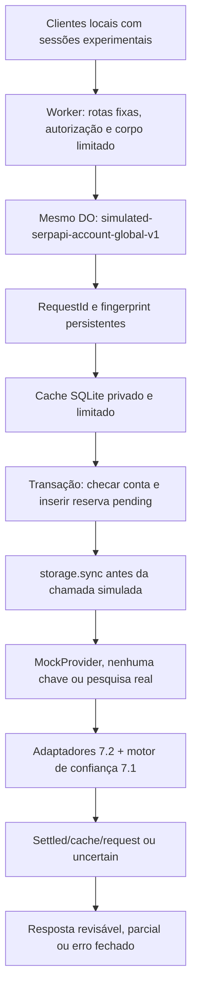

# Fase 7.3 — preparação local do gateway Cloudflare

Data: **21/11/2026, America/Sao_Paulo**; logs podem registrar 22/11 em UTC. Base: `8c0e15694cd159da02a717d1a2ee217e292b66f4`, branch `feature/android-preview-splash`, inicialmente limpa e igual ao remoto. PR #8 aberto, em rascunho e sem merge. Foram consultados os estudos 7.0/7.0.1 e os contratos, critérios e experimentos 7.1/7.2.

## Parecer

**Arquitetura demonstrada em workerd local; candidata condicional ao Free, ainda não pronta para deployment ou integração ao Wish.** Worker, Durable Object SQLite, persistência entre instâncias, orçamento compartilhado e falhas foram exercitados no runtime Cloudflare local. Isso é evidência adicional às regressões Node, mas não certifica CPU, memória, disponibilidade ou cobrança da plataforma remota. Nenhuma conta ou recurso Cloudflare foi criado, nenhum login/deployment foi feito e nenhuma pesquisa SerpApi real foi enviada.

O núcleo Wish continua offline, SQLite v5, Wish 1.0.0 / versionCode 5. Nenhum arquivo de produção, dependência do app, importador, preço, tema, package, assinatura ou migração foi alterado. Não houve APK, EAS Build, alteração da main/PR #5 ou merge.

## 1. Ambiente e instalação autorizada

O proprietário autorizou expressamente a instalação isolada depois de confirmar que não havia Wrangler/Miniflare/workerd utilizáveis. Foram instalados **Miniflare 4.20260730.0**, **workerd 1.20260730.1** (dependência exata/binário oficial Windows) e **esbuild 0.28.2**, pelo registro oficial npm. Node **24.22.1** já estava disponível; atende aos requisitos Node >=22 do Miniflare e >=18 do esbuild. Wrangler não foi necessário nem instalado.

Local: `D:\Projetos\Wish\experiments\cloudflare-gateway\.tools`. Manifests exclusivos `tools.package.json`/`tools.package-lock.json` fixam dependências e integridades, sem tocar em `package.json`/`package-lock.json` do aplicativo. O lock mantém a cadeia transitiva distribuída pelo Miniflare estável, inclusive bibliotecas transitivas com sufixos de pré-lançamento escolhidas pelo fornecedor; não significa que cada biblioteca transitiva seja uma release final independente. Nenhuma instalação global.

`.tools/`, `.local/`, `.wrangler/`, `.dev.vars*` e logs são ignorados no próprio experimento. Nenhum `node_modules`, estado SQLite, cache, perfil, sessão ou credencial é publicado. O procedimento de restauração isolada está no [README do laboratório](../experiments/cloudflare-gateway/README.md). Instalação consultou npm; pesquisa documental consultou fontes oficiais. A execução funcional usa somente loopback e provedor simulado.

## Medições locais registradas

Soma dos tamanhos lógicos dos arquivos em disco ao encerrar os ensaios (não alocação NTFS): ferramentas **163,241,518 bytes / 155.7 MiB**, 1.057 arquivos; artefatos/estados descartáveis acumulados de execuções **81,671,971 bytes / 77.9 MiB**. Não são dados do aplicativo; todos ficam ignorados. Novas execuções criam diretórios isolados e aumentam esse espaço. Nenhuma limpeza automática foi executada.

| Medida local | Resultado | Alcance |
| --- | --- | --- |
| Bundle final | 49238 bytes; gzip 16374 bytes | Arquivo esbuild; não upload/deploy. |
| Startup Miniflare | 154.6–638.0 ms, média 363.8 ms nos 39 startups registrados pela suíte | Subconjunto registrado antes dos testes adicionais; inclui processos/IPC, não CPU de init global. Medição com inspetor: 637.8 ms. |
| Latência identify, 10 operações | 77.2–463.7 ms, resposta 2.281 bytes | Mock, SQLite/IPC e profiler locais, sem rede da loja. |
| Latência compare, 5 operações | 165.9–290.6 ms, resposta 29.135 bytes | Duas chamadas mock por operação. |
| Heap V8 usado, antes/depois | 1498948 / 2716848 bytes | Instantâneos CDP, não pico nem memória total de Worker/DO. |
| Heap total V8 depois | 4980736 bytes; backing storage 783822 bytes | Não somar como se fosse toda a alocação do isolate. |
| CPU amostrada local | 182 amostras; 179 classificadas ativas; soma dos deltas 2678.5 ms em janela 2740.6 ms | Estimativa agregada por amostragem, afetada por espera/escalonamento; **não CPU metered por Worker/DO ou request**. |
| SQLite da amostra | 1658 linhas lidas / 237 escritas observadas, 15 operações e 20 chamadas mock | Cursores reais locais, inclui init/controles; não fatura remota. |
| Reservas/chamadas sem reserva | 20 / 0 | Nenhuma pesquisa real. |
| Cache da amostra | 15 entradas, 78935 bytes | Limites de eviction testados separadamente. |

Métricas/perfis brutos permanecem em .local/, sem conteúdo de sessão e fora do Git. Hardware, I/O, profiler e escalonamento influenciam esses números; nenhuma comparação com latência Android ou fornecedor real.

## 2. Auditoria de portabilidade

| Dependência/capacidade 7.2 | Situação e adaptação demonstrada |
| --- | --- |
| `node:http`, IncomingMessage, sockets/Buffer do servidor | Não entram no bundle. Worker usa Request/Response/ReadableStream; corpo <=32 KiB e leitura com deadline de 2 s. |
| `node:sqlite`, DatabaseSync e arquivos `.gateway.sqlite` | Não entram no bundle. DO usa `storage.sql.exec`, cursores, `transactionSync` e `storage.sync`. Seu schema `c_*` é independente do SQLite do Wish. |
| `node:fs`, `node:path`, mkdir/ACL/process lock | Não entram no bundle. Persistência é binding do DO; diretórios e scripts de medição são exclusivamente do harness Node. |
| `node:crypto` | **Mantido conscientemente**, somente hashes síncronos existentes dos adaptadores/fingerprint. RNG de sessão no harness; UUID de reserva por Web Crypto. `nodejs_compat` e data `2026-07-30` testados no workerd instalado. |
| `process`, env, arquivos de sessão, sinais CLI | Nenhuma leitura no caminho Worker/DO. Configuração experimental explícita via bindings; não carrega `.env` ou chave real. Harness e ferramentas continuam Node. |
| Locks de arquivo | Substituídos por uma identidade global de DO e transações síncronas. Não confiar somente em uma Map nem em “single-threaded” atravessando `await`. |
| Threads | Não são a garantia de orçamento: clientes paralelos chamam o mesmo DO. Os testes antigos de worker_threads continuam apenas como regressão Node. |
| Timers/AbortController | Reutilizados no runtime, limites por chamada/operação, cancelamento explícito por consumidor; testados em workerd. Relógio/espera não são medidores de CPU. |
| Maps de deduplicação | Mantidas dentro do DO para execuções simultâneas, complementadas por registros persistentes de requestId/reservas para reinícios. |
| Persistência/cache | SQLite do DO, privado por proprietário/variante/operação. Sem Cache API pública, D1, KV remoto, R2 ou banco do aplicativo. |

O bundle é construído por esbuild com target ES2022 e import externo explícito apenas de `node:crypto`. Seu metafile é verificado contra `store/http/cli` Node, app `src/` e dependências externas acidentais. O runtime executou hashes e adaptadores: não se deduziu compatibilidade apenas dos imports. A [documentação oficial de crypto](https://developers.cloudflare.com/workers/runtime-apis/nodejs/crypto/) descreve seu suporte; as [flags Node por data](https://developers.cloudflare.com/workers/runtime-apis/nodejs/) justificam a flag explícita para a data escolhida, anterior à mudança de defaults de agosto/2026.

## 3. Arquitetura efetivamente implementada

**Mesmo account coordinator para todos os dispositivos e proprietários.** Não há shard por dispositivo que multiplique a cota. `INTERNAL_TOKEN` aleatório protege o stub; bearer externo é verificado novamente no DO, nunca se confia em owner enviado pelo cliente. Endpoints públicos do laboratório limitam-se a `POST /v1/identify`, `/v1/compare`, `/v1/cancel`, sem query string, Origin ou host diferente de 127.0.0.1.

Reutilização real: `SearchGateway`, `MockProvider`, fixtures reconstruídas, `validate`, `fingerprint`, `adapt`, `cachedCandidates`, `assess` e critérios anteriores. Única alteração em 7.2: importar o tipo de armazenamento e aceitar uma porta `Pick` dos cinco métodos necessários. Não foram copiados ou flexibilizados critérios de identidade/preço para fazer o runtime passar.

Controles de teste ficam exclusivamente no stub local, atrás da capacidade interna, sem rota no Worker: stats, snapshot fictício, falhas, seeds declarados de teste e probe de saída interceptada. Existe uma barreira controlável no mock para testar cancelamento sem depender de uma corrida de 100 ms. **Esses controles e a autorização sintética são laboratório, não superfície administrativa de produção.** Não há manifest Wrangler ou fluxo de deploy.

## 4. Orçamento, concorrência e recuperação

- Snapshot **fictício** com `simulation/free=true`, ciclo `mock-*`, total 250, usado 14/saldo 236 por padrão. Não é leitura atual da conta. Ciclo do teste é curto e declarado; não corresponde à renovação real da SerpApi.
- Tetos: 200 reservas/ciclo, 40/hora móvel, manter 50 do saldo atestado. Assim, saldo fictício 236 admite no máximo **186** novas reservas, mesmo com teto operacional 200. Cada reserva pending/settled/uncertain conta. Nenhum refund presumido por erro, cache do fornecedor, timeout ou cancelamento.
- Toda chamada mock tem reserva transacional e `await storage.sync()` **antes** do efeito simulado. Registro de chamada usa uma reserva pending ainda não associada; unicidade impede usá-la duas vezes. Resultados e requestId também são persistidos antes da resposta de sucesso.
- Clientes do mesmo proprietário/produto/operação compartilham um job; outros proprietários usam cache/resultado próprios, mas consomem o **mesmo** orçamento. Cache não é deduplicação entre pessoas. Regra de rate por proprietário 20/min permanece.
- RequestId é escopado por proprietário e vinculado ao fingerprint. Repetição concluída devolve o resultado persistido por até 15 min; conteúdo conflitante é rejeitado. Repetição em andamento recebe conflito, não dispara nova chamada. Repetição incerta após reiniciar é bloqueada. Após 15 min, replay falha fechado sem pesquisar de novo, em vez de afirmar frescor indevido.
- Há limite conservador de **256 requestIds persistentes por estado experimental**, sem limpeza automática. Ao atingir, novas operações são recusadas. Isso limita armazenamento/replay, mas exige desenho de retenção/tombstones para produção. Não apagar tabelas para “liberar cota”.
- Reinicialização do Miniflare com o mesmo diretório reutiliza SQLite e cache; pending vira uncertain, sem zerar contador ou renovar ciclo. Uma chave com reserva uncertain fica bloqueada para novo envio. Reconciliar o saldo não libera silenciosamente essa identidade.
- Snapshot >1h, no futuro, fora do período ou ausente bloqueia novas reservas. Replay de snapshot (timestamp igual/anterior), variação inesperada de used/remaining, ciclo/período divergente deixam bloqueio persistido. Reconciliação local aceita somente sequência nova estritamente consistente; **não implementa rollover ou reconhecimento de uso externo**.
- Falha SQL/flush ativa latch fechado na instância. Falha ao concluir não libera a reserva. Ao reiniciar, schema incompleto é recusado em vez de recriar tabelas vazias de orçamento. Recuperação de corrupção requer intervenção fora deste escopo.

Atomicidade usa [`transactionSync` e SQL privados do DO](https://developers.cloudflare.com/durable-objects/api/sqlite-storage-api/); `sync()` resolve depois das escritas pendentes. Isso não cria uma transação distribuída com um fornecedor externo. Crash entre chamada e confirmação continua incerto; **não se promete exactly-once entre provedores e SQLite**. Os testes reiniciam instâncias reais locais e injetam falhas antes/depois da chamada, não simulam falha física de disco ou desastre de datacenter.

Apagar/restaurar todo o estado ou usar outro namespace/coordenador pode retroceder contadores: nenhum banco local prova sozinho consumo de uma conta externa depois de rollback. Antes de qualquer produção são obrigatórios identidade imutável por conta, reconciliação externa autenticada, restauração que comece bloqueada e protocolo de reservas incertas aprovado. Nada disso justifica consultar a API real nesta fase.

## 5. Autenticação mobile: comparação e recomendação

| Opção | Benefícios | Limites e trabalho pendente |
| --- | --- | --- |
| Identidade gerenciada, OAuth/OIDC + authorization code/PKCE | Provedor cuida da identidade; gateway valida issuer/audience/assinatura/expiração e restringe sub ao proprietário. Navegador externo; nenhum client secret confiado à APK. | Requer escolher provedor, política gratuita/quotas/recuperação, redirect/app links e validação rigorosa de tokens. Nenhuma conta, SDK ou integração criada. |
| Pareamento autorizado pelo proprietário | Android gera material próprio; desafio curto e de uso único é aprovado fora de banda. Pode limitar o serviço a poucos dispositivos pessoais. | Administrador deve ter autenticação independente. Resistir a brute force, phishing, repetição, troca de dispositivo, revogação e perda. Um código permanente ou primeiro acesso aberto não serve. Não é “gratuito em segurança”; maior responsabilidade operacional. |
| Sessões curtas e revogáveis | Token opaco individual, hash no servidor, escopo identify/compare, expiração curta; revogar dispositivo sem trocar chave do provedor. | É complemento a uma identificação/pareamento seguro, não um bootstrap. Renovação/rotação, armazenamento protegido no Android e revogação persistente exigem desenho aprovado. |

Para app nativo público, usar navegador do sistema e PKCE, não WebView/login embutido nem segredo fixo de cliente: [RFC 8252](https://www.rfc-editor.org/rfc/rfc8252), [RFC 7636](https://www.rfc-editor.org/rfc/rfc7636). A [BCP OAuth atual, RFC 9700](https://www.rfc-editor.org/rfc/rfc9700), fundamenta proteção contra replay/redirect e cuidado com refresh tokens. [RFC 8628](https://www.rfc-editor.org/rfc/rfc8628) descreve Device Authorization Grant; um pareamento particular não deve ser anunciado como implementação desse padrão sem cumprir seu protocolo e análise de ameaças.

**Recomendação de planejamento:** identidade gerenciada com PKCE para habilitar opcionalmente somente a pesquisa online, allowlist do proprietário, e sessões curtas/revogáveis no gateway. Validar um fornecedor realmente gratuito antes de adotá-lo; não há conta selecionada. Pareamento manual é alternativa pessoal sem fornecedor de identidade, condicionada a aprovação de seu bootstrap/recuperação. Nenhuma opção torna login obrigatório para abrir/cadastrar/offline no Wish. Chave SerpApi fica somente em secret de servidor futuro; Android recebe autorização individual, nunca a chave do provedor. Não implementar autenticação produtiva neste protótipo.

O teste atual usa tokens aleatórios de 256 bits em memória, hashes em bindings e validade <1h; testa ausente/inválido/expirado/revogado e escopo de cancelamento. A revogação demonstrada é da configuração local da instância, **não um diretório mobile persistente de dispositivos**. Controle do computador local é parte do modelo de confiança; não representa isolamento contra outro processo do mesmo usuário.

## 6. Segurança e testes adversariais

- Endpoints fixos, validação existente de dados planos/identificadores/tamanho, rejeição de propriedades extras e URLs privadas, não HTTPS, com credenciais/segredos.
- URL do produto nunca se torna destino de rede. Não há proxy ou resolução de URLs encurtadas, scripts de loja, autenticação/CAPTCHA ou bypass de proteção.
- `cf:false` desativa a obtenção automática de metadados Cloudflare documentada no [Miniflare](https://developers.cloudflare.com/workers/testing/miniflare/get-started/). Sem remote bindings. `outboundService` intercepta toda saída com 403; a probe negativa comprova isso antes do transporte externo. Preloader Node nega fetch/http/TCP/TLS/DNS/UDP externos e bind público; não é firewall de sistema operacional.
- Instâncias e inspetor ficam em loopback; sem túnel, alteração de firewall ou exposição à rede local/celular. `dispose()` fecha recursos.
- Cache privado: identidade <=24h, comercial <=15min, vazio 60s, <=128 entradas/2 MB, item normalizado <=200 KB. Resultado HTTP também <=200 KB; corpo recebido <=32 KiB; entradas/arrays limitados no motor. RequestIds podem reter até ~51,2 MB de resultados limitados, separados dos 2 MB de cache, com teto 256; não confundir esses tetos.
- Sem logs de payload/header/token: erros estáticos/sanitizados e métricas agregadas. SQLite/cache são privados de desenvolvimento, não criptografados ou protegidos contra o dono do disco. Não há garantia de ACL NTFS baseada em mode Unix.
- Índice/cache continuam revisão: nenhuma oferta vira confirmação da loja por estar no gateway. `commercialFresh` representa janela do cache/transporte, **não prova de preço/estoque/PIX/cupom atual**. Parcelas, totais conflitantes, modelo incorreto e esgotados permanecem com evidência/condição original e critérios 7.1 inalterados.

## 7. Validação e medições

| Verificação final | Resultado |
| --- | --- |
| Runtime local Cloudflare | **46/46 testes**, 0 falhas, 0 cancelados, 0 ignorados; inclui caso que grava resumo de medições. Worker e DO executados em workerd, não apenas mocks de interfaces Node. |
| Regressões anteriores | **310/310**, 0 falhas: 75 gateway Node + 103 confiança + 5 guardas POC + 127 app/SQLite. |
| Total executado aprovado | **356/356** no conjunto final. |
| TypeScript | npm run typecheck aprovado. |
| ESLint | EXPO_OFFLINE=1 EXPO_NO_TELEMETRY=1 npm run lint aprovado. |
| Bundle | Grafo auditado, sem servidor/SQLite/filesystem Node nem código de produção. |
| Provedor externo / Android / cloud | Não executados; nenhuma conclusão de compatibilidade real por loja, APK ou Free remoto. |

Comandos reproduzíveis no README do laboratório. Regressões: node --require ./experiments/search-gateway/offline-loopback.cjs --experimental-strip-types --test experiments/search-gateway/gateway.test.mjs experiments/product-confidence/engine.test.mjs experiments/serpapi-poc/guards.test.cjs tests/*.test.mjs. Testes novos: node --require ./experiments/search-gateway/offline-loopback.cjs --test experiments/cloudflare-gateway/runtime.test.mjs.

Testes no runtime: autorização e revogação, entradas/rotas/Origin/tamanho inválidos, SSRF como dado, concorrência de clientes, duas identidades com cache privado e orçamento único, singleflight, replay/conflito, snapshot stale/replay/inconsistência, reserva de segurança de 50, 40/hora e 200/ciclo, cache por bytes/entradas, persistência/reinício, falha reserve/sync/finish, falha SQL real e schema corrompido após reinício, timeout, cancelamento por proprietário e por consumidor compartilhado, resultados parciais, identidade errada, parcelas/totais e respostas grandes. Uma tentativa nativa de saída é **interceptada**, sem pesquisa real; os demais cenários registram zero tentativa de saída.

Durante a validação, a primeira exportação de constante não-handler foi recusada pelo workerd; virou constante interna. A revisão acrescentou recusa de schema incompleto ao reiniciar. Os primeiros testes de cancelamento dependiam de vencer um mock de 100 ms e falharam sob IPC/carga; foram substituídos por barreira explícita do mock, mantendo as mesmas asserções de cancelamento, consumidor remanescente, reserva única e ausência de refund. Nada foi desabilitado para passar.

Amostragem CDP usa o alvo real workerd do script. O target reúne Worker e DO; não oferece atribuição metered confiável de CPU por invocação/por componente. Soma dos deltas de amostras ativas é uma aproximação local afetada por espera, profiler, SQLite síncrono e escalonamento Windows, **não CPU cobrada**. Heap CDP é instantâneo do V8; não é RSS, pico nem toda a memória nativa/SQLite do isolate. Não foram forçados OOM ou esgotamento de CPU do host. Rejeições de payload/cache são limites do protótipo, não simulação certificada dos erros 1102 da Cloudflare. Não há teste remoto ou físico Android nesta entrega.

## 8. Limites atuais do Free e custos

Fontes oficiais consultadas nesta data; rever antes de criar recursos. [Workers limits](https://developers.cloudflare.com/workers/platform/limits/): 100 mil requests/dia, CPU 10 ms/request no Free, memória 128 MB/isolate, 50 subrequests/request, startup global 1 s e bundle **64 MiB descompactado** na documentação atual, sem teto gzip. Não reutilizar os antigos limites de 3/10 MiB como se fossem atuais. Variável/binding textual por variável: 5 KB; os payloads grandes de teste são fixtures locais, não proposta de carregá-los em env de produção.

[DO pricing](https://developers.cloudflare.com/durable-objects/platform/pricing/): Free admite somente backend SQLite; 100 mil requests/dia, 13 mil GB-s/dia, 5 milhões de linhas lidas/dia, 100 mil escritas/dia e 5 GB totais. No Free, exceder limites faz operações falharem; o reset diário é 00:00 UTC. A [página DO limits](https://developers.cloudflare.com/durable-objects/platform/limits/) descreve CPU padrão de 30 s e explica no FAQ **1 GB por objeto no Free**, apesar da tabela genérica indicar 10 GB. Adotar o menor teto explicitamente aplicável; confirmar enquadramento de CPU antes de produção, sem assumir que tempos medidos do processo Node equivalem aos limites Free. SQLITE_FULL deve resultar em recusa, nunca liberar pesquisa.

**Custos nesta etapa: R$ 0,00 de serviços contratados; zero créditos SerpApi e zero builds EAS.** Não foi consultada cobrança/conta Cloudflare. Para hospedagem futura, manter exclusivamente Free, sem upgrade/cartão/auto cobrança contratada, com recusa ao atingir limites e fallback offline/manual. Gratuidade perpétua não é garantida por código: depende dos termos vigentes e de revisão explícita.

Cenário próprio, não benchmark de produção: 200 reservas/ciclo permitem no máximo 200 operações de uma chamada ou 100 comparações de duas, antes de cache e da margem de saldo (236 fictícios reduzem para 186/93). Se 200 operações de até 5 s fossem concentradas em um dia, só o tempo conectado a 128 MB equivale aproximadamente a 125 GB-s; retenção/hibernação, replays, autenticação e tráfego abusivo podem elevar consumo. NÃO é previsão exata de faturamento. Na amostra local, obter média de SQL por operação serve para estimar escala, não para garantir teto sob scans, índices ou ataques. Taxa de requests Cloudflare inclui cache/auth/erros, não apenas reservas SerpApi.

A separação proposta mantém parsing, confiança e SQL no DO e deixa o Worker fino. Se CPU do Worker ultrapassar 10 ms, reduzir trabalho duplicado e mover validação pesada para o DO mantendo autenticação/limite de corpo no ingresso; pré-compilar tabelas/normalizadores e limitar lotes, sem relaxar identidade. Se DO/memória forem excessivos, paginar ofertas/serialização e reduzir retenção física mantendo tombstones e orçamento, com nova avaliação. Se ainda não couber no Free, manter gateway Node local opcional e o núcleo manual/offline; **não migrar automaticamente para plano pago**.

## 9. Pendências antes de qualquer deployment

1. Autorização específica de conta/recursos/hospedagem; confirmar Free, termos, limites e ausência de cobrança. Este laboratório não contém receita autorizada de deployment.
2. Escolher e aprovar bootstrap mobile, issuer/audience/escopos, revogação/renovação persistente, armazenamento Android e recuperação do proprietário. Nenhum segredo estático de APK.
3. Remover controles de teste e substituir bindings sintéticos por configuração validada; secret real só no servidor após autorização. Revisar logs, ACL administrativa, limites por origem/dispositivo e prevenção de abuso antes do DO.
4. Projeto de reconciliação autenticada do fornecedor, incerteza, rollover e restauração anti-rollback. Uma única identidade de coordenador por conta real, sem orçamento replicado por região/dispositivo/namespace.
5. Validar CPU separada Worker/DO, startup global, memória/picos, falhas 1102/SQLITE_FULL, quotas de SQL/duração e indisponibilidade na plataforma autorizada. Não aprovar Free somente pelo bundle pequeno ou testes Node/local.
6. Política de retenção dos requestIds, tombstones/replay, cache privado e expiração; TTL de sessões, replay e evidencia não pode renovar preços. Avaliar scans SQL e crescimento acumulado.
7. Só então propor transporte SerpApi com endpoint fixo e limites de corpo/tempo/redirecionamento. Nenhuma consulta real, loja ou integração é autorizada implicitamente pelo êxito deste protótipo.

**Conclusão:** avançar apenas mediante nova autorização para o próximo experimento definido. O protótipo comprova as propriedades locais indicadas e preserva o aplicativo; autenticação produtiva, garantias de custo Free e execução remota continuam pendentes. PR #8 permanece rascunho, sem merge.
