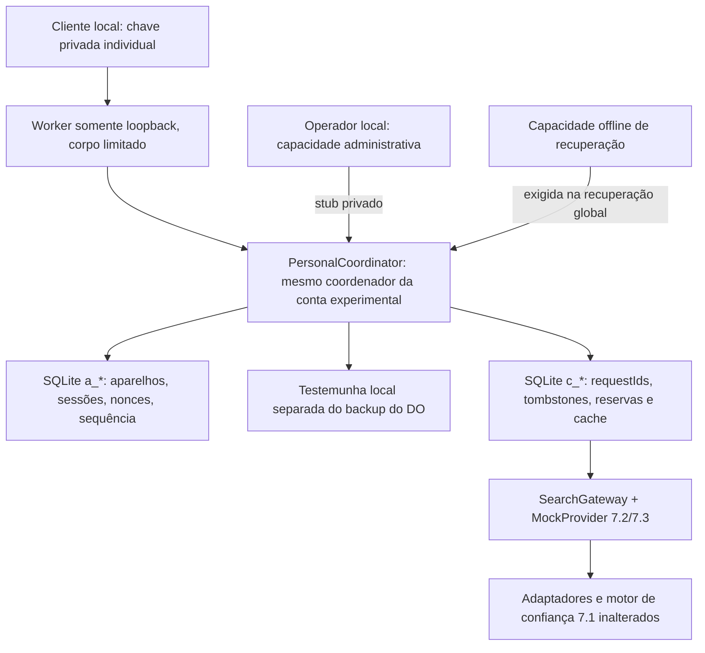

# Fase 7.4 — autenticação pessoal e recuperação do gateway

Data: **21/11/2026, America/Sao_Paulo**. Base publicada: `9f7dbe0ae1976dd4811ae343a62b697773400693`, branch `feature/android-preview-splash`, inicialmente limpa/sincronizada. PR #8 permanece em rascunho. Escopo exclusivamente experimental/local, com as ferramentas isoladas e fixadas na Fase 7.3; nenhuma instalação nova.

## Resultado e decisão

**Pareamento pessoal implementado e exercitado em Worker/Durable Object SQLite no workerd local. Não é autenticação de produção nem autorização para implantação.** Cada dispositivo tem chave individual ECDSA P-256, aprovação explícita do operador, sessão opaca de até cinco minutos e provas de posse com nonces de uso único. Revogação e recuperação persistem; nenhuma chave fixa de APK ou refresh bearer permanente é aceita como identidade do dispositivo.

O núcleo offline do Wish não foi alterado e não exige login. Nenhuma conta/provedor de identidade, recurso Cloudflare, consulta SerpApi real, APK, EAS Build ou integração ao app. SQLite v5, versionCode 5, importador, preços, estética, dependências de produção, main e PR #5 preservados.

**Reservas incertas não foram liquidadas por inferência:** há revisão estruturada, manutenção do débito e bloqueio de repetição, mas nenhum reembolso/desbloqueio baseado em um comprovante inventado. Restauração declarada, testemunha ausente/inconsistente, confirmação perdida ou operação interrompida falham fechadas. Rollback simultâneo e não declarado de todos os estados não pode ser certificado localmente; garantia produtiva depende de âncora independente que esta fase não cria.

## 1. Pareamento versus OAuth/OIDC + PKCE

| Alternativa | O que exige | Decisão nesta fase |
| --- | --- | --- |
| OAuth/OIDC com Authorization Code + PKCE | Provedor/autorizador real, configuração de cliente público, issuer/audience, JWKS, redirect/app links, navegador externo, política gratuita e recuperação. | Comparado, não implementado ou substituído por um IdP falso. Sem conta e evidência real não seria possível validar esse conjunto de garantias. Continua candidato preferível para identidade gerenciada futura. |
| Pareamento pessoal autorizado | Operador local confiável, conferência independente da impressão digital da chave, assinatura de desafio, registro e revogação por aparelho. | Implementado como laboratório local, sem depender de identidade externa. Mais responsabilidade de bootstrap/recuperação; não é automaticamente solução adequada à internet. |
| Sessões curtas com prova da chave | Autorização anterior do dispositivo, nonce contextual e token curto; sessão não substitui a origem da identidade. | Implementado como complemento do pareamento, com renovação e reautenticação por chave. |

[OAuth para apps nativos, RFC 8252](https://www.rfc-editor.org/rfc/rfc8252) recomenda navegador externo e proteção PKCE para clientes públicos. [RFC 9700](https://www.rfc-editor.org/rfc/rfc9700) atualiza as práticas de segurança OAuth, incluindo riscos de replay e tokens de renovação. Isso não significa que PKCE autentique sozinho o dono do aparelho. Não foi escolhido fornecedor ou presumida gratuidade de um IdP.

O protocolo local de prova contextual **não se apresenta como OAuth, OIDC ou DPoP**. [RFC 9449](https://www.rfc-editor.org/rfc/rfc9449) especifica DPoP com regras próprias; usar uma chave por aparelho não implementa esse padrão. Este protocolo particular precisa de revisão independente antes de qualquer uso remoto; não deve virar padrão proprietário do aplicativo por inércia.

## 2. Componentes e fronteiras de confiança



- `personal-auth.ts`: estados de pareamento, prova ECDSA/SHA-256, sessões, revogação, recuperação, fences e compactação de resultados.
- `personal-worker.ts`: entrada HTTP pessoal e `PersonalCoordinator`, que reutiliza o coordenador/armazenamento/gateway anteriores. Uma conta pessoal e um owner fixo interno, compartilhados pelos aparelhos aprovados.
- `personal-harness.mjs`: clientes de teste de operador/dispositivo e testemunha persistente de desenvolvimento, fora da árvore de backup do DO.
- `personal.test.mjs`: testes com assinaturas reais Web Crypto verificadas em workerd, sem IdP, credenciais externas ou API de pesquisa real.
- `boundary.ts`: extração sem mudança de comportamento das respostas, erros e leitura limitada já existentes; usada também no experimento 7.3.
- `build.mjs`/`harness.mjs`: selecionam explicitamente a entrada pessoal; o caminho legado continua apenas para regressões, sem fallback de autenticação na entrada pessoal.

O laboratório pessoal usa classe/estado experimental próprios. Não importa automaticamente saldos, sessões ou arquivos de experimentos anteriores. Há uma única identidade de coordenador **dentro da conta/linhagem pessoal testada**; namespace/className/linhagem não são algo que o cliente possa escolher. Isso não demonstra orçamento compartilhado entre servidores independentes operados com configurações diferentes, nem migração de dados de um gateway real.

Os clientes de teste representam os papéis no mesmo computador; não há UI de aprovação nem teste humano/Android. O helper `enroll` assume o papel do operador apenas nos testes: o servidor não aprova automaticamente pedidos. Não copiar esse helper, contexto administrativo ou segredo de recuperação para um cliente móvel.

## 3. Protocolo demonstrado

### Bootstrap e autorização de aparelho

1. Cliente gera chave privada P-256 não extraível pela API Web Crypto do harness; transmite somente JWK público `kty/crv/x/y`. Chave privada, campos desconhecidos, curva inválida e coordenadas malformadas são recusados. Não se afirma proteção por hardware/Android Keystore.
2. `POST /auth/pair/start` recebe chave/label e registra dispositivo **pending**, com desafio aleatório de 256 bits, prazo de 120 s e fingerprint SHA-256 da serialização pública fixa.
3. Operador compara a fingerprint calculada no cliente por canal confiável independente. Pelo stub local, usando capacidade administrativa aleatória, chama `/operator/approve` com ID e fingerprint exatos. Fingerprint divergente, operador incorreto, pedido expirado ou já consumido são recusados.
4. Cliente assina o contexto de pareamento e envia `/auth/pair/complete`. Aprovação sem assinatura da chave correspondente não basta. Desafio é consumido uma única vez; emitido token aleatório de 256 bits, guardado no servidor apenas como hash, com sessionId e expiração.

### Sessão e prova por operação

Sessão padrão **300.000 ms**, sem extensão implícita por atividade. Apenas o harness pode reduzir esse prazo para testes; não pode exceder cinco minutos. Headers `Authorization`, `X-Wish-Session`, `X-Wish-Nonce` e `X-Wish-Signature` são verificados contra dispositivo/sessão persistentes.

`POST /auth/challenge` exige sessão ativa e recebe somente rota permitida e SHA-256 do corpo JSON. Emite nonce de 256 bits, <=60 s, vinculado à sessão, caminho e hash. A assinatura P-256/SHA-256 cobre campos separados por **LF (byte 0x0A)**:

```text
wish-personal-v1
request
<sessionId>
<nonce>
POST
<path>
<SHA-256 de JSON.stringify(input)>
```

Pareamento usa contexto `wish-personal-v1 / pair / deviceId / challenge`; reautenticação usa `wish-personal-v1 / device / deviceId / nonce`, com o mesmo separador LF. Não é JSON Canonicalization Scheme: a serialização do corpo segue `JSON.stringify` do objeto recebido após parse, conservando sua ordem. Cliente deve assinar exatamente essa representação; divergência falha, sem flexibilizar verificação. Nonce é consumido antes da operação do gateway; repetição da mesma assinatura, corpo alterado, endpoint diferente ou chave errada são recusados. Comparação dos hashes secretos usa `timingSafeEqual` após validação de comprimento.

`/auth/renew` exige sessão ainda ativa e prova contextual; revoga a sessão antiga e retorna outra. **Após expiração**, `/auth/device/challenge` e `/auth/device/complete` permitem à chave de um dispositivo já aprovado e com pareamento concluído provar novamente sua posse, obter sessão curta e revogar sessões anteriores desse aparelho. Não há refresh token bearer permanente. Identificador público sozinho, pairing ainda incompleto, chave errada, nonce repetido e dispositivo revogado não autorizam reautenticação.

### Revogação

`/operator/revoke` marca o aparelho como revogado, invalida suas sessões e desafios de sessão. A verificação de status também bloqueia desafios de reautenticação pendentes. Outro dispositivo aprovado continua autorizado. Não basta aguardar expiração: a revogação é consultada no SQLite em cada admissão/prova e sobrevive ao reinício.

O coordenador pessoal serializa operações completas para tornar a interação com a testemunha conservadora; fila limitada a 16. **Operação já admitida pode terminar antes da revogação/cancelamento enfileirado.** Revogação vale para novas operações após processada; não desfaz chamadas anteriores nem devolve créditos. O cancelamento da entrada pessoal não tem a mesma capacidade de interromper um job em andamento da entrada concorrente 7.3. Isso é limitação explícita de disponibilidade/UX e bloqueio para integração remota até projetar controle prioritário sem quebrar os fences. As regressões 7.3 continuam verificando seu cancelamento original.

## 4. Modelo de ameaças

| Ameaça / ator | Controle implementado | Limitação residual |
| --- | --- | --- |
| Solicitante sem autorização | Pending + aprovação local + assinatura individual; nenhuma autoaprovação ou cadastro de conta. | Operador precisa comparar fingerprint corretamente; não há UI humana validada. |
| Bearer roubado | Chave correspondente e nonce contextual obrigatórios; expiração curta; revogação consultada. | Roubo da chave privada permite agir como o aparelho até revogação. Não foi testado armazenamento seguro Android. |
| Replay / corrida de assinatura | Nonce persistente de uso único e serialização; sessionId/rota/corpo/contexto assinados. | Protocolo particular, sem auditoria independente; sem alegação de conformidade DPoP. |
| Pedido de pareamento sequestrado | Fingerprint conferida pelo operador e prova da chave. | Canal de comparação comprometido ou aprovação negligente quebra o bootstrap. |
| Dispositivo tentando administrar | Rotas administrativas ausentes no Worker; header administrativo removido do tráfego cliente; stub exige capacidade separada. | Processo local que controla harness/operador está no perímetro confiável. |
| Restauração antiga do DO | Contador/linhagem numa testemunha fora do backup do DO; fences antes/depois; restauração declarada bloqueada. | Rollback conjunto não declarado de DO e testemunha, edição maliciosa dos dois estados ou controle do host não são detectáveis com garantia. |
| Falha entre escrita e confirmação | Transações, sync, flag inflight e CAS na testemunha; confirmação perdida mantém bloqueio. | Prioriza segurança sobre disponibilidade; não há reparo automático que invente evidência. |
| Tentativa de liberar reserva incerta | Relatório de revisão, débito retido, mesma chave de consulta bloqueada; payloads de “receipt” recusados. | Liquidação individual exige evidência real do provedor e protocolo futuro, não implementados. |
| DoS / acúmulo de estado | Fila 16, corpo 32 KiB, rates persistentes, limites de aparelhos/sessões/nonces/resultados/requestIds. | Não substitui proteção de borda em serviço público; IDs públicos podem ser usados para esgotar rate de reautenticação e causar indisponibilidade. |
| SSRF / fuga de chave | Rotas fixas, URLs de produto apenas como dados, saída negada e sem chave real carregada. | Não houve pentest externo, TLS real ou avaliação Android. |
| Log / backup indevido | Sem impressão de tokens/chaves; hashes no DO; `.local` ignorado e estados separados dos arquivos do Wish. | Disco não criptografado pelo laboratório; não é defesa contra administrador/malware local. |

Capacidade administrativa local é autoridade raiz: quem a controla pode aprovar aparelhos. Exigir também o código offline na recuperação global **não transforma toda a administração em autenticação de dois fatores**. Rotação da autoridade raiz, TLS, identidade do operador, atestação de hardware e cofre de segredos são requisitos produtivos pendentes, não funcionalidades alegadas.

## 5. RequestIds, retenção e tombstones

- Reutiliza journal `c_request` da 7.3, hash de owner/requestId e fingerprint de conteúdo. Aparelhos pessoais compartilham owner; trocar de aparelho não torna válido repetir o mesmo ID para conteúdo diferente.
- Novo nonce/prova é sempre obrigatório, inclusive para ler um replay. Resultado retido e fresco pode ser devolvido sem pesquisa adicional; conteúdo conflitante recebe 409.
- Até **16 resultados completos** (cada um <=200 KB), por até **15 min de frescor lógico**. Resultados vencidos ou excedentes são compactados para `state=tombstone, data=NULL`; IDs/fingerprints não são apagados para liberar capacidade.
- Compactação ocorre no próximo acesso autorizado, não em timer de background; se o serviço estiver parado/bloqueado, bytes podem permanecer no disco além de 15 min. Cache normalizado privado permanece com limites anteriores (<=2 MB/128 entradas), separado dos resultados de replay (até ~3,2 MB).
- Tombstones, falhas e IDs incertos permanecem no journal; **teto total 4.096**, sem limpeza automática/reutilização por idade. Atingir o limite retorna 429. É limite experimental conservador de vida do estado, não política de retenção infinita pronta para operação contínua.
- Repetição de tombstone não dispara nova pesquisa nem renova preço. Não se mudou a interpretação de preço/evidência: índice/cache não viram preço confirmado em loja.
- Política produtiva futura deve preservar tombstones/checkpoints contra rollback durante todo horizonte de retry, definir rollover/retirada segura e privacidade. Apagar journal ou criar outro namespace para contornar limites não é procedimento autorizado.

Outros tetos experimentais: 32 registros de dispositivos ao longo da vida do estado, sem expurgo automático de chaves revogadas; 64 sessões ativas após limpeza de expiradas/revogadas na emissão; 128 nonces pendentes; pairing start 10/min global, complete 20/min global, desafios/provas/reauth 20/min nos respectivos escopos por dispositivo. Falhas/expirações não liberam orçamento de pesquisa.

## 6. Reservas incertas e reconciliação

Permanecem os limites 7.3: 200 reservas/ciclo fictício, 40/h, margem de 50 do saldo atestado; reserva e flush antes da chamada mock. pending/settled/uncertain contam igualmente. Não houve consulta do saldo real da SerpApi, renovação real de ciclo ou evidência de cobrança.

`/operator/reconcile` aceita corpo vazio e retorna reservas incertas com decisão **retained-no-retry**, `release:false`, `externalEvidenceRequired:true`. Não aceita um “receipt” fornecido pelo cliente nem converte um erro/timeout em prova de que nada foi consumido. Não altera contador, snapshot, estado de consumo ou chave bloqueada. Pode ser usado para revisão autorizada; **liquidação e desbloqueio automático não foram implementados**.

Mesmo evidência externa agregada de saldo não identifica necessariamente qual chamada foi consumida. Uma fase futura precisará definir conta/ciclo, identidade de execução, referência do fornecedor, evidência autenticada e auditável e política para casos irresolúveis. Exactly-once entre fornecedor e SQLite não é prometido. O protocolo de recuperação de acesso não é reconciliação financeira.

## 7. Reinício, recuperação e restauração anti-rollback

### Testemunha local efetiva

Uma service binding de Miniflare aponta para implementação Node local com arquivo JSON persistente **fora da árvore de estado/backup do Durable Object**. Armazena lineage, sequência monotônica e horário observado. Cada CAS usa lock de arquivo exclusivo, escrita em arquivo novo, fsync e rename; conflito/erro/corrupção/horário regressivo é recusa, sem retry de pesquisa. Locks órfãos não são removidos por TTL ou automaticamente. Não se promete durabilidade física NTFS contra perda de energia, nem exclusão distribuída de um filesystem remoto.

A binding e seu destino são fixos, não selecionáveis pelo cliente. É uso local documentado de [service bindings do Miniflare](https://developers.cloudflare.com/workers/testing/miniflare/core/multiple-workers/), sem serviço em nuvem. Não é uma testemunha remota simulada com garantia fictícia: é um arquivo local real com propriedades e perímetro limitados.

Antes de cada operação, DO compara linhagem/seq e avança a testemunha, persiste seq/`inflight=1` e aguarda sync. Antes de responder sucesso, persiste a transição, avança a testemunha novamente e persiste `inflight=0`. Assim, snapshot intermediário não vira um checkpoint concluído. Erro normal fecha a operação se for possível fazê-lo com segurança; erro de armazenamento/ack perdido não é “corrigido” adivinhando a sequência. Reinício normal preserva sessões, revogações, nonces e tombstones; inflight interrompido ou seq divergente bloqueia.

Uma cópia antiga só do DO não passa sob a testemunha mais nova. Duas cópias concorrentes do mesmo checkpoint não podem ambas avançar a testemunha; conflitos podem deixar ambas indisponíveis, o que é permitido pela política de falha fechada.

### Limite que não pode ser provado aqui

Se **todos** os estados confiáveis forem restaurados juntos sem declaração, o sistema local pode voltar a observar exatamente a configuração anterior. Não há evidência independente para distinguir esse caso de um histórico legítimo. Isso é uma limitação do modelo de confiança, não algo resolvido por assinar o mesmo backup, trocar um hash ou ler o próprio SQLite.

Uma restauração conhecida deve ser iniciada com `RESTORE_DECLARED=yes`; nesse modo nenhuma recuperação administrativa ou pesquisa pode desbloquear o serviço. Há teste mesmo com DO e testemunha antigos consistentes. Sem testemunha no disco, o harness de retomada não a recria silenciosamente. Restaurar/editar a testemunha junto para ganhar compatibilidade é proibido pelo procedimento; a flag não detecta magicamente um operador que o omita.

**Antes de uso remoto é obrigatória âncora independente do conjunto restaurável, evidência verificável do orçamento e procedimento de recuperação aprovado.** Não há código produtivo de retomada por evidência externa nesta fase; quando falta a evidência necessária, continua bloqueado. Núcleo offline do Wish segue utilizável, pois não foi integrado ao gateway.

### Procedimento seguro de recuperação de acesso demonstrado

1. Suspender pesquisas online; preservar estado, journal, testemunha e backups. Não reinstalar app, limpar dados, editar SQL, apagar lock/counters ou criar namespace substituto.
2. Operador em ambiente confiável consulta status sob witness atual. Se houver mismatch, restore declarado, corrupção, falta de testemunha ou inflight pendente, **parar**; não usar recuperação de credenciais como bypass. Recuperação/restauração externa exige nova aprovação e evidências.
3. Para perda de aparelho/chave com estado íntegro, usar capacidade administrativa local **e** código offline de recuperação aleatório de 256 bits, previamente guardado separado dos aparelhos/backups e nunca na APK/Git/chat. No laboratório essas capacidades são sintéticas, geradas em memória pelo harness; não são credenciais reais do proprietário.
4. `/operator/recover` revoga todos os aparelhos/sessões e invalida desafios de sessão, sem apagar desejos (inacessíveis a este código), cache, requestIds, tombstones ou reservas. Rotaciona o hash do código de recuperação e devolve o novo código somente ao operador na resposta sem cache; não o imprime nem grava em arquivo público. O antigo é recusado, inclusive após reinício.
5. Guardar a nova capacidade em local confiável separado e aprovar a fingerprint do novo aparelho; provar sua chave e emitir sessão curta. Conferir que orçamento/journal continuam iguais. Outros aparelhos só voltam por nova aprovação.
6. Se forem perdidas todas as autoridades necessárias, a recuperação global fica indisponível. Se a resposta com o código novo se perder, não se supõe que o código antigo ainda funcione; não há reset silencioso. O operador ainda pode revogar aparelhos individualmente se conservar sua autoridade, mas a reposição da autoridade/código offline não é uma funcionalidade implementada de produção.

O procedimento foi exercitado por clientes locais automatizados de papéis separados. Não inclui UI móvel, cofre de senhas, proteção física da máquina, recuperação humana ou credencial real emitida ao proprietário.

## 8. Testes e verificações

| Verificação final | Resultado |
| --- | --- |
| Autenticação/recuperação em workerd | **37/37 aprovados**, 0 falhas, 0 cancelados/ignorados; suíte completa após corrigir serialização das provas. |
| Runtime Cloudflare 7.3 | **46/46 aprovados**, sem falhas; mantém cobertura de orçamento, persistência, cancelamento e rede. |
| Node/SQLite anteriores | **310/310 aprovados**: gateway 75, confiança 103, guardas POC 5, app/SQLite 127. |
| Total de testes distintos | **393 aprovados; 0 falhas finais**. Reexecuções dirigidas não são somadas novamente. |
| TypeScript | npm run typecheck aprovado. |
| ESLint | npm run lint aprovado, Expo offline/sem telemetria. |
| Bundles locais | Pessoal: **62.456 bytes**; legado de regressão: **49.280 bytes**. Grafo sem código do app, servidor Node ou SQLite de filesystem no Worker. |
| Rede/provedor | Saída externa negada. Nenhuma pesquisa SerpApi, conta/recurso remoto ou crédito consumido. A probe negativa herdada da 7.3 é interceptada localmente. |
| Físico/remoto | Não executados; sem declaração de segurança Android, TLS, IdP real, durabilidade física ou compatibilidade metered com Free. |

Logs reproduzíveis ficam ignorados em .local/personal-tests.log, .local/phase74-runtime-regressions.log e .local/phase74-regressions.log. Não contêm impressão de credenciais do dispositivo/operador; respostas de falha nos novos testes omitem payloads de sessão deliberadamente.


Cenários: pairing pendente/expirado, aprovação errada, chave inválida/privada, assinatura errada, replay de pareamento, token legado/ausente, bearer roubado, prova vinculada a corpo/rota, corrida de nonce, expiração injetada e natural, renovação, reautenticação por chave após expiração, reauth negada para ID roubado/pairing incompleto/revogado/replay, revogação por aparelho e após restart, cache/orçamento pessoal compartilhado, requestId conflitante/replay, compactação de 17 resultados para 16+tombstone, teto 4.096, tombstone após restart, nonce após restart, revisão de reservas incertas, recuperação/rotação/replay após restart, witness fora do ar/ausente/corrompida, ack perdido, linhagem divergente, rollback do relógio, backup antigo/clones concorrentes, restauração declarada dos dois estados e falha de sync.

Correções durante a validação: erros de inicialização da classe negada eram propagados sem envelope pelo cliente administrativo do harness; agora viram erro local sanitizado 503, como a entrada Worker já fazia. Um desencontro de separador nas novas provas de reautenticação foi detectado; protocolo e clientes foram fixados explicitamente em LF, mantendo rejeição de corpo/rota/chave/replay. Não foram relaxadas assinaturas, removidas asserções de segurança ou usadas respostas fictícias de um IdP para declarar compatibilidade real.

Não houve teste físico Android/Keystore, OAuth real, internet pública, TLS, desastre de datacenter, restauração Cloudflare ou medição metered do Free. Os bundles locais são pequenos, mas crypto, fences e testemunha adicionam trabalho/latência. A implementação Node da testemunha não pode ser enviada junto como se fosse um binding remoto existente. A viabilidade do Free da 7.3 permanece condicional, sem recertificação de CPU/custo.

## 9. Reproduzir sem serviços externos

Na raiz `D:\Projetos\Wish`, com as ferramentas isoladas já instaladas:

```powershell
node experiments/cloudflare-gateway/build.mjs personal
node experiments/cloudflare-gateway/build.mjs
node --require ./experiments/search-gateway/offline-loopback.cjs --test experiments/cloudflare-gateway/personal.test.mjs
node --require ./experiments/search-gateway/offline-loopback.cjs --test experiments/cloudflare-gateway/runtime.test.mjs
node --require ./experiments/search-gateway/offline-loopback.cjs --experimental-strip-types --test experiments/search-gateway/gateway.test.mjs experiments/product-confidence/engine.test.mjs experiments/serpapi-poc/guards.test.cjs tests/*.test.mjs
npm run typecheck
$env:EXPO_OFFLINE='1'; $env:EXPO_NO_TELEMETRY='1'; npm run lint
```

Todos os testes usam loopback, `cf:false`, nenhuma remote binding e saída externa negada. Testemunha é callback local, não consulta HTTP a Cloudflare/SerpApi. Instâncias são fechadas com dispose. Estados, backups, witnesses, locks, bundles e logs ficam em `.local/`, ignorados. Não imprimir/serializar o contexto retornado pelo harness: contém capacidades sintéticas de administração/recuperação. Nenhum arquivo de credencial é versionado.

## 10. Checklist obrigatório antes de implantação ou integração

- [ ] Nova autorização explícita de escopo, recursos e operação remota; não implantar estes arquivos por simples remoção da checagem de loopback.
- [ ] Escolher autenticação produtiva: IdP real PKCE/OIDC com validação issuer/audience/chaves/redirect ou revisão independente completa do pareamento. Sem segredo fixo na APK, sem login obrigatório no núcleo offline.
- [ ] Identidade administrativa, proteção de chaves/recuperação e revogação da autoridade raiz, UI humana de fingerprint e política para perda de respostas/códigos. Avaliar keystore Android e armazenamento móvel sem alegar hardware seguro a partir do harness.
- [ ] Âncora anti-rollback independente, restauração inicialmente bloqueada, protocolo de evidência externa/reconciliação de contas/ciclos/reservas, tratamento de split-brain e de locks órfãos. Não excluir testemunha/journal para “corrigir”.
- [ ] Proteger endpoints públicos com TLS, limites de borda/DoS, CORS/Host corretos, contexto/audience de assinaturas e protocolo padronizado/revisado. Remover `/operator/test`, separar os papéis reais e nunca publicar capacidades de operador no cliente.
- [ ] Revisar prioridade de cancelamento/revogação sob filas, deadlines e indisponibilidade da testemunha sem quebrar fences ou devolver orçamento incerto.
- [ ] Política produtiva de retenção/tombstones/rotação de dispositivos, privacidade e criptografia/ACL de backups; controlar crescimento sem reabrir replay.
- [ ] Medir CPU Worker/DO, memória, I/O, latência e quotas reais de Free. Manter custo obrigatório R$ 0,00; sem plano pago ou contratação automática como fallback. Se não couber, manter laboratório local e app manual/offline.
- [ ] Só após aprovação, propor transporte real SerpApi e integração ao Wish. Esta fase não autoriza chave real, pesquisa, banco remoto, APK ou EAS.

**Entrega experimental local concluída conforme os resultados finais abaixo. Autenticação produtiva, liquidação externa e restauração com evidência independente continuam pendentes de análise/autorização. PR #8 em rascunho, sem merge.**
