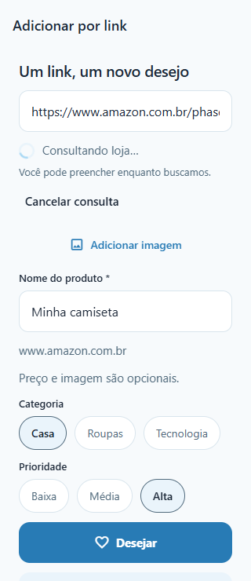

# Fase 8.0 — importação e experiência de compra

Data: 22/11/2026. Base: `584d466366fb8b657380133122470413e6c4a872`. Branch exclusiva: `feature/android-preview-splash`, PR #8 em rascunho. Wish 1.0.0 / Android versionCode **5** / `com.danielsln.wish` / SQLite **v5**.

## 1. Resultado e limites

Implementado um rascunho utilizável antes da resposta da loja, com edição manual durante a consulta, cancelamento, proteção contra respostas antigas e salvamento direto por **Desejar**. O editor seguro de imagens existente agora atende produtos ainda não cadastrados. Início e Categorias exibem pendentes; comprados ficam exclusivamente em Comprados. A identidade azul-claro, os temas, os cinco destinos e as demais telas foram preservados.

Não foi implementada importação universal, pesquisa por nome, comparação automática ou integração experimental. O gateway continua **NO-GO**, conforme a Fase 7.5. Nenhuma conta, chave, API SerpApi, serviço remoto, dependência, migração, APK ou EAS Build foi utilizada/criada. Testes de lojas desta fase são fixtures; não comprovam compatibilidade com as páginas reais. Não houve validação física Android.

## 2. Auditoria inicial

Estado inicial limpo, HEAD local/remoto `584d466`, branch correta; PR #8 aberto, draft, sem merge e sem conflitos. Main permaneceu em `29dea24eeddbb2cb4f04caf48b70c1f35e710f11`. PR #5/Supabase não foi alterado.

| Área | Funcionalidade existente / decisão da auditoria |
| --- | --- |
| Cadastro e edição | ProductForm, validação, UUID/repository.save, gate de salvamento, categoria sugerida, prioridade Média, preço/imagem opcionais. Reutilizados. |
| Importação | JSON-LD Product/ProductGroup/graph, Open Graph, microdata e estruturas públicas de lojas já suportadas; seleção conservadora por URL/IDs/variantes. Mantidos. |
| Segurança de rede | HTTPS público validado, hosts exatos, família de redirects, até quatro redirects, limite global de 12 s e corpo de 2 MB em streaming, sem retries, execução de JS, autenticação ou CAPTCHA. Preservados. |
| Imagens | Seleção por resolução/metadados, CDN vinculado à loja, proporção e limite de ampliação para miniaturas, placeholder/falha, editor com validação de bytes e armazenamento privado. Editor antes restrito a produto com ID. |
| Detalhes | Imagem/nome/preço, ações acessíveis, notas editáveis, descrição expansível e condições recolhidas. URLs técnicas não aparecem em texto bruto. Mantidos. |
| Ofertas | CRUD manual, confirmação do mesmo modelo/variante, loja/preço/link/data/condição, normais e condicionais separados. Já atende a preparação de Onde comprar; sem duplicar uma seção. |
| Organização | Busca, categorias e ordenação existentes. Início permitia também comprados e Categorias contava ambos, contrariando a separação solicitada. Corrigido na consulta da UI. |
| Persistência | SQLite v5, migrações/backup/repositório e preferências existentes. Nenhum arquivo de `src/data` alterado. |
| Desempenho | FlatList virtualizada e dimensões das imagens já limitadas. Principal gargalo demonstrado era esperar a rede antes de mostrar o rascunho e antes de carregar categorias. Sem otimizações especulativas de listas ou memória. |
| Experimentos 7.x | Diretório separado, testes e ferramentas locais ignoradas. Não importados por `src`; ausência verificada também no source map do bundle Android. |

### Problemas corrigidos

- URL e preenchimento manual eram bloqueados durante a consulta; o rascunho só aparecia após rede e categorias.
- Debounce de 900 ms somava espera à primeira consulta; reduzido para 300 ms como intenção de UI, sem alterar limites de segurança/rede.
- A proteção de intenção passa a abranger troca de link, edição opcional, cancelamento, retry, blur e salvamento; respostas obsoletas não atualizam a tela.
- Mesclagem respeita campos tocados, inclusive imagem, categoria, prioridade, texto vazio e preço nulo. Uma falha de implementação que convertia preço nulo em string vazia foi detectada na revisão e corrigida antes da entrega, com regressão específica.
- O formulário opcional agora conserva a categoria já existente no rascunho quando o nome é editado. Cadastros novos sem categoria continuam recebendo sugestão.
- Timeout, cancelamento e conexão tinham explicação conjunta. Agora são distintos, mantendo o prazo original.
- Produtos comprados e contagens de categoria não estavam alinhados. Início/Categorias consultam apenas pendentes; Comprados consulta apenas comprados. Exclusão de categoria continua protegendo também produtos comprados.
- Eliminada ação manual duplicada: com rascunho há edição por lápis; sem rascunho, Preencher manualmente fica imediatamente disponível.

## 3. Fluxos antes e depois

**Antes:** colar → aguardar debounce/rede/categorias com campos bloqueados → prévia → Desejar ou formulário opcional.

**Agora:** colar → rascunho imediato com link/loja → nome/categoria/prioridade e imagem podem ser escolhidos enquanto a consulta acontece → metadados disponíveis completam apenas campos não tocados → Desejar valida e salva diretamente → lista com confirmação discreta.

- Carregamento discreto informa consulta/recebimento/preparação. Informações comerciais só entram depois da leitura integral e da validação: não se publica preço de um trecho HTML que possa conter outra variante mais adiante.
- Cancelar interrompe a consulta, conserva campos e permite nova tentativa explícita. Falha conserva também a última prévia válida, se havia uma atualização em andamento; isso não significa preço atualizado.
- Trocar o endereço inicia uma intenção de produto nova, descartando o rascunho daquele endereço para não misturar produtos. Resposta anterior é invalidada por geração, URL e AbortSignal.
- Editar informações cancela a consulta e abre uma cópia estável no formulário existente. Cancelar edição recupera a prévia original, sem refazer a consulta automaticamente. Concluir salva sem outra revisão obrigatória.
- Desejar congela o rascunho e invalida a consulta **antes do primeiro await**. Gate e trava síncrona impedem toques consecutivos. Falha de armazenamento mantém os campos e libera nova tentativa.
- Sem nome/categoria válidos são solicitados somente esses campos. Preço e imagem podem permanecer ausentes.
- Colar usa o menu nativo do campo; não foi adicionado botão de clipboard sem API/dependência já disponível. Copiar cupom nativamente continua pendente.

`ImportSession` é exclusivamente memória/controle de intenção. Não acessa SQLite, não persiste sessão, não importa laboratórios nem faz rede. React lê snapshots estáveis com useSyncExternalStore; não há polling de UI.

## 4. Qualidade, preços e imagens

Revisadas e preservadas as regras de seleção da produção. Produto/anúncio/variante conhecidos são comparados por identificadores já suportados; múltiplos candidatos sem escolha inequívoca não fornecem imagem/preço arbitrários. Conflitos explícitos não viram ausência silenciosa. Essas regras não identificam infalivelmente kits, gerações, tamanhos, cores ou acessórios em páginas com metadados incompletos; o usuário deve confirmar nome/modelo/variante. Não se usou o motor experimental para elevar confiança.

Preços comuns, PIX, final explícito com cupom/PIX+cupom continuam com suas condições. Cupom sem total final não gera cálculo; parcelas, frete não identificado, preço anterior, validade inválida, estoque indisponível e variante conflitante não são promovidos a preço integral anunciado. Evidências comerciais e URL original permanecem preservadas; preço editado manualmente mantém anotação de ajuste. Fixtures históricas HyperX permanecem somente nos testes, nunca valores fixos em produção.

O editor de imagens reutilizado aceita galeria nativa ou URL HTTPS direta validada, prévia, cancelar, remover e confirmar. Para rascunho sem ID, devolve a referência ao formulário; não cria produto provisório nem executa saveImage no banco. Para produto existente, mantém a atualização exclusiva de imagem já implementada.

Mantidos JPEG/PNG/WebP/GIF, limite de 8 MB/20 MP, sem base64 no SQLite, hash/deduplicação, arquivos privados persistentes, proporção e origem. Uma imagem confirmada manualmente é campo tocado e não pode ser substituída por resposta tardia. Não se inventam URLs nem se retiram parâmetros de CDN.

**Limite conhecido:** confirmar foto em um rascunho e depois abandoná-lo pode deixar arquivo privado sem produto associado. A política existente não coleta arquivos automaticamente para não apagar referências compartilhadas; nenhum arquivo antigo é apagado. Fotos nativas locais funcionam sem rede por arquitetura; a nova entrada da galeria precisa de validação física. Galeria persistente não é implementada na web; URLs remotas dependem de rede/CORS.

Ofertas registradas continuam explicitamente manuais e não verificadas em tempo real, com condição e data, separadas por comparabilidade. Não há campo confiável de estoque/atualização automática no esquema existente; não foi inventada disponibilidade nem procedência importada para registros manuais. Não se anuncia melhor preço da internet.

## 5. Matriz de lojas

Esta matriz descreve **política de código e evidência histórica**, não novos acessos bem-sucedidos a lojas nesta fase. Hosts exatos estão em `src/services/import-policy.ts`.

| Origem | Cadastro manual de HTTPS público válido | Consulta automática | Encurtador | Limitações |
| --- | --- | --- | --- | --- |
| Amazon Brasil | Sim | Hosts revisados | a.co, somente redirect verificável da mesma família | Bloqueio/JS/CORS/identidade podem impedir dados. Falha física anterior não foi declarada resolvida. |
| Mercado Livre | Sim | Hosts revisados | meli.la, mesma família | MLB/MLBU/anúncio/vendedor/variante preservados; bloqueios anteriores continuam possíveis. |
| KaBuM! | Sim | Hosts revisados | Sem encurtador adicional | Metadados públicos e preços condicionais existentes; sem estimar cupom, checkout ou frete. |
| Magalu | Sim | Hosts revisados | Não adicionado | SKU/seller/variante e metadados podem não estar disponíveis; loja dinâmica/bloqueio não contornados. |
| Casas Bahia | Sim | Hosts revisados | Não adicionado | Dependência de JS/ausência de dados podem exigir manual. |
| Youcom | Sim | Hosts revisados | Não adicionado | Metadados/imagens sujeitos à fonte e resolução realmente publicada. |
| Shopee | Sim | **Não** | Não resolvido automaticamente | Nenhuma consulta DNS/HTTP arbitrária; preencher manualmente. |
| AliExpress | Sim | **Não** | Não resolvido automaticamente | Ter adaptador/host de imagem testado por fixture não habilita transporte automático. |
| Outros / Google Shopping | Sim, se URL segura | Somente destino explicitamente autorizado | Wrappers Google explícitos são decodificados localmente; sem consulta ao Google | Texto compartilhado com vários links exige escolha. Página Shopping opaca ou loja não revisada é manual. |

Mensagens distinguem bloqueio 403/429/CAPTCHA, redirecionamento não verificável, página dependente de JS, ausência/conflito de produto, HTTP indisponível, conexão, timeout e cancelamento. A UI não apresenta códigos internos como promessa de suporte. Falta de preço não impede salvar nome/categoria válidos.

## 6. Desempenho e escopo das medições

Mesma fixture local com atraso de 1.200 ms, Chromium/Windows, 320×740, rota previamente carregada, contexto SQLite isolado. São amostras de diagnóstico, não percentis de produção nem Android.

| Medida após colar | Antes | Depois |
| --- | --- | --- |
| Rascunho disponível | 2.404,6 ms | 66,9 ms |
| Primeira requisição | 933,5 ms | 362,5 ms |
| Metadados disponíveis | Aproximadamente a mesma espera do rascunho | 1603,0 ms |
| URL editável durante consulta | Não | Sim |
| Preenchimento manual disponível durante consulta | Não | Sim, campos essenciais + lápis |

A redução de espera foi no bloqueio da UI e debounce. Não se acelerou a loja, não se ampliou timeout e não se provou menor latência no Android. O texto da página é reutilizado nos dois testes de shell/CAPTCHA em vez de removê-lo duas vezes. Benchmark de parser (3 aquecimentos/15 amostras) teve medianas de 0,249→0,171 ms para 133 bytes e 29,509→21,348 ms para 1.224.052 bytes em amostras sem outras suítes ativas. Uma tentativa com outras cargas chegou a 62,254 ms no caso grande. A dispersão e a ausência de medição Android não sustentam uma melhoria geral; não se promete ganho de CPU/memória por essa pequena alteração. Parsing continua síncrono após corpo limitado; custo em aparelho lento é pendência física.

Catálogo sintético web de 500 registros: 400 pendentes/100 comprados, dez cards na janela inicial da FlatList. Busca, ordenação, categorias, temas e reabertura exercitados. A amostra final levou 167,7 ms entre toque e contagem carregada. Medições constam no JSON publicado. Não é medição de heap, consumo Android ou benchmark comparativo do banco; não foi feita otimização especulativa de virtualização.

## 7. Testes e evidências

| Verificação | Resultado final |
| --- | --- |
| Regressões anteriores + novas | **428 testes distintos aprovados, 0 falhas/skips/cancelados** = 415 anteriores + 13 novos. |
| Consolidado Node/SQLite | **323/323**: 140 do aplicativo + 103 motor de confiança + 75 gateway Node + 5 guardas da POC. |
| Runtime Cloudflare anterior | **46/46**, local e simulado. |
| Autenticação/recuperação | **37/37**, workerd local. |
| Readiness adversarial | **22/22** na repetição isolada final, sem alterar código ou limites. |
| Web | **16 suítes distintas aprovadas**, 0 pageErrors; inclui 72 cenários de navegação (6 larguras × 6 escalas × 2 temas). Repetidas as suítes relacionadas após a última correção de categoria. |
| TypeScript / ESLint | Aprovados no código final, sem erros/avisos. |
| Export web / Android | Aprovados localmente com CLI já instalada. Android é bundle JS/Hermes, **não APK nem EAS Build**. |
| Isolamento Android | Um source map, **1395 fontes, zero módulos de experiments/gateway/confidence/POC**. |
| Expo Doctor 1.21.8 | **19/20**, permanece falhando a verificação de versões: @expo/ui 58.0.28→~58.0.29; expo 58.0.25→~58.0.26; filesystem 58.0.13→~58.0.14; router 58.0.31→~58.0.32; sqlite 58.0.17→~58.0.18; web-browser 58.0.8→~58.1.0. Não atualizados/ocultados. |
| Auditoria de exposição experimental | **NO_GO/exit 1 esperado**, 11 bloqueios preservados; não equivale a falha nova do app ou permissão para deployment. |
| Galeria | 40 capturas na revisão completa, 12 selecionadas com referência antes/depois e estados desta fase; imagens reais da UI com fixtures. |
| Android físico / APK | **Não executados**. |

Regressões de preços cobrem comum/PIX/cupom final/sem final/PIX+cupom, banners, parcelas, estoque, preço anterior, conflitos e variantes; regressões SQLite cobrem cadastro/edição/exclusão/categorias/notas/ofertas/comprados/reabertura. Testes novos cobrem edição durante fetch, troca/cancelamento de intenção, resposta tardia/progresso/erro ignorados, categoria tardia, null/zero, congelamento e falha de salvamento, progressos de transporte e mensagens distintas.

### Comandos reproduzíveis (ferramentas já instaladas)

```powershell
# Regressões Node/SQLite, sem rede externa; inclui os 13 testes novos
node --require ./experiments/search-gateway/offline-loopback.cjs --experimental-strip-types --test experiments/search-gateway/gateway.test.mjs experiments/product-confidence/engine.test.mjs experiments/serpapi-poc/guards.test.cjs tests/*.test.mjs
# workerd local: executar separadamente para não disputar o relógio do cenário de 1.200 ms
node --require ./experiments/search-gateway/offline-loopback.cjs --test experiments/cloudflare-gateway/runtime.test.mjs
node --require ./experiments/search-gateway/offline-loopback.cjs --test experiments/cloudflare-gateway/personal.test.mjs
node --require ./experiments/search-gateway/offline-loopback.cjs --test experiments/cloudflare-gateway/readiness.test.mjs
npm run typecheck
npm run lint
# expo-doctor 1.21.8: utilizar executável já instalado, sem instalar/atualizar pacote
node node_modules/expo/bin/cli export --platform web --output-dir .expo/phase80/export-web --max-workers 2
node node_modules/expo/bin/cli export --platform android --output-dir .expo/phase80/export-android --source-maps --max-workers 2
node --experimental-strip-types tests/benchmarks/import-parser.mjs after
# Servidor de desenvolvimento somente loopback; sem túnel
npm run web -- --localhost --port 8118
```

Para navegador, apontar WISH_PLAYWRIGHT_MODULE para o Playwright **já existente no ambiente**, WISH_CHROMIUM_PATH para o Chrome instalado e WISH_TEST_URL para http://127.0.0.1:8118. Cada script cria contexto novo e não reutiliza o perfil do proprietário. Executados `node tests/ui/<nome>.cjs` para navigation, import-flow, smart-details, store-readiness, expandable-description, phase61, phase62, phase63, phase63-images, phase64, phase65, phase65-cards, tab-labels, phase80 e phase80-list; `node tests/ui/promotions.mjs`; `node tests/ui/phase65-review.cjs after` para galeria; `node tests/ui/phase80-timing.cjs` para medição web. O ambiente não instala Playwright automaticamente.

### Tentativas intermediárias e limites do harness

- O novo teste inicialmente esperava nome amigável “Amazon” para uma fonte ainda não consultada; corrigido para o hostname realmente derivado do link, sem inventar nome da loja.
- ESLint identificou setState desnecessário num efeito de seleção. Removido; limpeza de erros já ocorre nos eventos que alteram o endereço.
- Seletores antigos usavam a presença de Desejar como sinal de consulta concluída. Agora aguardam o nome/metadado esperado antes de validar preço/categoria; asserções foram preservadas. Seleção de estado vazio foi limitada ao elemento visível, pois rotas empilhadas mantêm árvores ocultas.
- A asserção antiga de produto comprado na lista principal foi atualizada para a seção Comprados; o novo teste verifica também sua ausência em Início/Categorias e a reversão.
- Servidor Expo executado em CI não observa alterações posteriores nos arquivos. O teste novo de categoria identificou uma execução com bundle anterior à correção; o servidor foi reiniciado para a verificação final. Não se confundiu o arquivo no disco com o código servido.
- Um teste adversarial de expiração do laboratório falhou por não chegar ao gate antes da expiração de 1.200 ms durante execução concorrente com outras cargas. Não se alterou o laboratório, a expiração ou a proteção. A repetição isolada final passou os 22 testes, inclusive esse caso; permanece uma sensibilidade de tempo do harness sob carga, não uma garantia de desempenho remoto.
- A primeira tentativa web offline partiu de uma carga direta da rota e encontrou dependência de módulos/worker do servidor Expo de desenvolvimento. O teste final aquece as rotas carregadas antes de desligar a rede. Isso valida operações offline do aplicativo carregado, **não** inicialização web fria/PWA. Android instalado não é certificado por esse teste.
- Primeiro teste novo de timeout esperava número de segundos que a mensagem antiga não expunha. A distinção real de timeout/conexão foi implementada e o cenário mantém a espera real pelo prazo de 12 s, sem retries.

Logs/medidas completos em `.expo/phase80/`, ignorados no Git. Ferramentas existentes: Node 24.22.1, Playwright já disponível no ambiente, Chrome instalado, Expo CLI local, Doctor 1.21.8 já em cache; nenhuma instalação. Testes Cloudflare usam as ferramentas locais fixadas na 7.3, workerd/Miniflare/mock e loopback, sem SerpApi real.

### Evidências visuais reais

Capturas do aplicativo executado no Chromium, catálogo e imagens explicitamente sintéticos, sem dados pessoais. CSS de fontes ampliadas não equivale a fontScale, TalkBack ou teclado Android. Arquivos selecionados em `docs/phase-8-0/`; a galeria completa de teste fica ignorada em `.expo/phase80/gallery/after`.

[Abrir galeria selecionada](phase-8-0/index.html) · [Medições e consolidação das suítes](phase-8-0/measurements.json)



[Prévia escura ampliada](phase-8-0/preview-dark-320-scaled.png) · [Timeout](phase-8-0/timeout-dark-320.png) · [Cancelamento](phase-8-0/cancel-dark-320.png) · [Detalhes e PIX](phase-8-0/light-details-pix.png) · [Ofertas manuais](phase-8-0/dark-details-offers.png) · [Lista ampliada](phase-8-0/list-dark-320-scaled.png).

## 8. Persistência e funcionamento offline

Sem mudanças em esquema, migrações, backups, repositório, package/lockfile, assets, configurações Android/EAS ou versionCode. Desejos, fotos, categorias personalizadas, condições, notas, ofertas, comprados e tema usam as mesmas estruturas. Não houve operação sobre o catálogo do proprietário: Node usa bancos de teste e navegador usa contextos novos.

Núcleo local continua sem login/backend. Imagens remotas/lojas e importação precisam de rede; fotos privadas locais não. Expo Go depende do servidor para carregar o bundle; web de desenvolvimento não possui garantia de boot frio offline. Não desinstalar ou limpar dados para validar atualização. A migração histórica v4→v5 continua sem aprovação física.

## 9. Arquivos e organização futura do PR #8

Produção: `src/domain/import-session.ts`, `src/app/products/import.tsx`, `src/app/(tabs)/add.tsx`, `src/app/(tabs)/categories.tsx`, `src/components/wishlist.tsx`, `src/components/product-form.tsx`, `src/components/image-editor.tsx`, `src/services/product-import.ts`, `src/services/import-messages.ts`.

Testes: `tests/phase80-session.test.mjs`, `tests/ui/phase80.cjs`, `tests/ui/phase80-list.cjs`; ajustes dos seletores/fluxos em import-flow, smart-details, store-readiness, phase63, phase64, phase65 e phase65-review. Documentação: este relatório, README e capturas selecionadas. Nenhum experimento foi alterado/removido.

Proposta **somente documental**, não executada: organizar a revisão acumulada por (1) aplicativo/persistência histórica e identidade 6.x, (2) importador e UX 6.3–6.5/8.0, (3) pesquisa/experimentos 7.x e seus bloqueios. Para cada grupo, revisar diff, evidências e pendências separadamente, mantendo a ordem/dependências das migrações já autorizadas. Fazer inventário do diff final contra main e repetir validação de atualização antes de qualquer decisão de integração. Se futuramente desejar separar entregas/PRs, exigir autorização específica e planejar preservação de histórico; nesta fase não houve divisão de branches, rebase, squash ou merge. PR #5/Supabase permanece independente e adiado.

Commits organizados por controle de importação, imagem/organização e testes/documentação. A autoria vinculada a DanielSln, hashes publicados e estado remoto são conferidos na entrega; não criar commits vazios só para registrar hashes no próprio relatório.

## 10. Checklist físico para uma futura APK v6

Somente após autorização para preparação/versionCode e outra autorização para compilação:

- [ ] Instalar como atualização sobre a v5, mesma assinatura/package, sem desinstalar/limpar dados.
- [ ] Conferir desejos, categorias personalizadas, fotos privadas, notas, ofertas, comprados e tema antes/depois.
- [ ] Android: colar de navegador/Google Shopping/apps, teclado/rolagem/foco, campos e Desejar alcançáveis.
- [ ] Consulta lenta: preencher nome/categoria/prioridade, escolher imagem, cancelar/repetir/trocar URL; não sobrescrever escolhas.
- [ ] Salvar enquanto consulta está em voo; duplo toque; navegar/suspender/retornar; resposta antiga não reabre nem modifica produto.
- [ ] Editar nome sem trocar categoria escolhida; cancelar edição e comparar a prévia original; salvar edição diretamente.
- [ ] Galeria: prévia, cancelar, confirmar, remover; fechar/reabrir; foto local sem internet e sem deformação; limites de tamanho/formato.
- [ ] PIX/cupom explícito, sem final, parcela, esgotado, variante/kit/cor divergentes; comparar com loja real, sem presumir checkout.
- [ ] Desejar sem preço/imagem; falha real de rede/armazenamento conserva campos e permite retry.
- [ ] Marcar comprado some de Início/Categorias e aparece em Comprados; reverter restaura a categoria correta.
- [ ] Ofertas manuais comuns/condicionais, preço original intacto, notas, descrição longa e abrir loja.
- [ ] Temas claro/escuro/automático, fonte Android ampliada, TalkBack, telas pequenas/rotação, lista extensa.
- [ ] Abrir APK sem rede: lista, fotos locais, detalhes, notas, ofertas e preferências persistentes.
- [ ] Repetir casos reais Amazon/ML/KaBuM/Youcom/lojas dinâmicas, classificando bloqueio/redirect/JS/ausência/conflito; não equiparar fixture a suporte real.

**Não preparar versionCode, APK, merge, integração externa ou nova fase sem autorização explícita.**

## Referências técnicas consultadas

- [Expo SDK 58](https://docs.expo.dev/versions/v58.0.0/) e [expo/fetch](https://docs.expo.dev/versions/v58.0.0/sdk/expo.md).
- [Expo Router](https://docs.expo.dev/versions/v58.0.0/sdk/router.md), [ImagePicker](https://docs.expo.dev/versions/v58.0.0/sdk/imagepicker.md) e [FileSystem](https://docs.expo.dev/versions/v58.0.0/sdk/filesystem.md), sem atualizar pacotes.
- [React useSyncExternalStore](https://react.dev/reference/react/useSyncExternalStore), snapshots estáveis/subscrição.
- [React Native TextInput](https://reactnative.dev/docs/textinput) e [Expo CLI/export](https://docs.expo.dev/more/expo-cli.md).
- Relatórios locais das Fases 6.4/6.5/7.0/7.5 e código/testes existentes; não foi consultada API comercial para este diagnóstico.
