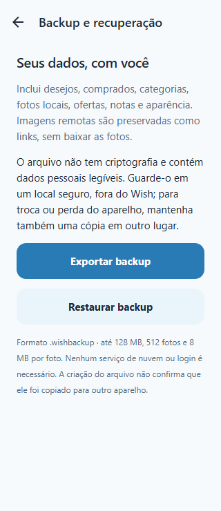
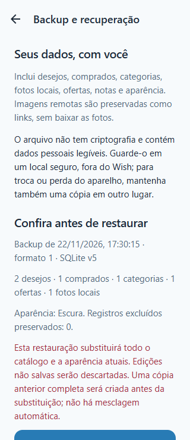
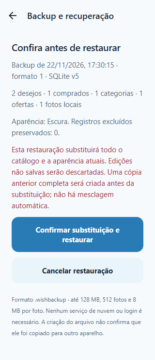
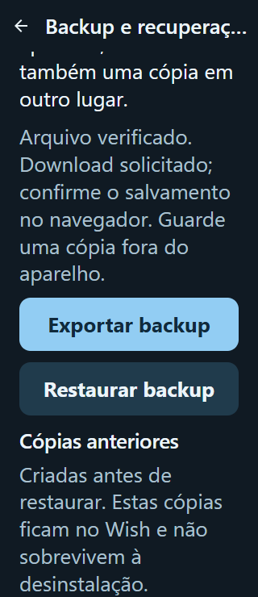
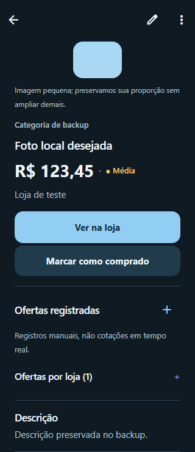
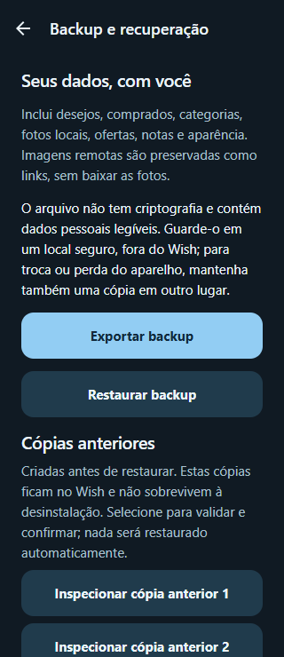
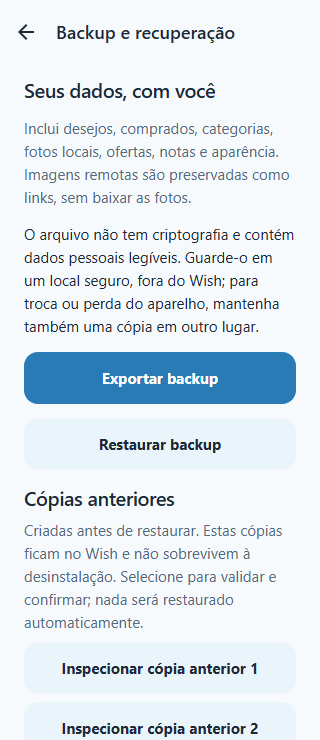

# Fase 9.0 — Backup e recuperação local

Data: 22/11/2026. Base auditada: `4af68363424b4d587e4633c9646acbab1695d681`, branch `feature/android-preview-splash`, PR #8 aberto/em rascunho. **Implementação e validação local concluídas; Android físico pendente. Nenhuma APK ou EAS Build nesta fase.** A APK v6 estável continua sendo a da Fase 8.1, aprovada pelo proprietário; ela ainda não contém esta funcionalidade.

## Auditoria e decisões

- O esquema existente é SQLite v5, com `categories`, `products`, `product_offers` e `app_settings`. Migrações e backup pré-v5 continuam intactos. O snapshot histórico usa `backupDatabaseAsync` + verificação; não era uma exportação portátil com fotos nem uma tela de restauração.
- Fotos privadas existentes ficam em `document/wish-product-images/<sha256>.<ext>`, referenciadas por `wish-image://<sha256>.<ext>`, deduplicadas por conteúdo. Reutilizamos os validadores e o persistidor de imagens; nenhuma foto antiga é excluída.
- As dependências já instaladas fornecem seleção de arquivo/pasta, arquivos e handles assíncronos (`expo-file-system ~58.0.13`), SHA-256 (`expo-crypto`), decodificação (`expo-image`) e transações (`expo-sqlite`). Nenhuma dependência, permissão de configuração, plugin nativo ou lockfile foi adicionado/alterado. `expo-sharing` não foi instalado: a alternativa implementada no Android é **salvar numa pasta escolhida**, não uma folha de compartilhamento.
- Consultamos os contratos do [SDK 58](https://docs.expo.dev/versions/v58.0.0/), [FileSystem](https://docs.expo.dev/versions/v58.0.0/sdk/filesystem/), [SQLite](https://docs.expo.dev/versions/v58.0.0/sdk/sqlite/) e [Image](https://docs.expo.dev/versions/v58.0.0/sdk/image/), e as implementações nativas instaladas. Handles usam explicitamente `FileMode.ReadOnly`/`Truncate`; provedores Android SAF não suportam o modo padrão read/write.
- Banco ativo nunca é copiado como arquivo bruto. Exportamos linhas permitidas sob transação de leitura, consistente com o WAL. Um coordenador por conexão serializa o repositório/tema e impede mutações incompatíveis durante manutenção.
- O núcleo offline continua sem autenticação ou servidor. Nenhum módulo experimental entra no fluxo de backup. `app.json`, `eas.json`, dependências, esquema/migrações, importador e experimentos não foram alterados: **1.0.0 / versionCode 6 / SQLite v5**.

## Como usar

**Configurações → Backup e recuperação.**

Exportar:
1. Leia o aviso: arquivo **sem criptografia**, contendo dados pessoais legíveis.
2. Toque em **Exportar backup**. Android: escolha uma pasta externa pelo seletor do sistema. O Wish cria um arquivo novo, fecha, relê e confere seu conteúdo antes de confirmar.
3. Guarde outra cópia em local seguro fora do aparelho. A cópia dentro do armazenamento privado do Wish não sobrevive à desinstalação. Nenhum serviço de nuvem foi integrado.
4. No navegador, o arquivo é validado antes de solicitar download. A mensagem pede para confirmar o salvamento: a aplicação não pode garantir que o navegador efetivamente gravou o arquivo em disco.

Restaurar:
1. Toque em **Restaurar backup** e selecione um `.wishbackup`.
2. A cópia selecionada é inspecionada integralmente, incluindo fotos. Android usa um arquivo temporário privado, em blocos; o original selecionado é preservado.
3. Confira data, formato, SQLite v5, desejos/comprados/categorias/ofertas/fotos, aparência e aviso de substituição. Cancelar essa prévia não altera o catálogo.
4. **Confirmar substituição e restaurar** substitui todo o catálogo, sem mesclar. Edições não salvas são descartadas. Antes disso, uma cópia completa do estado atual é gravada, relida e validada.
5. Após confirmação, as telas e o tema são recarregados. Repositórios antigos não podem salvar formulários obsoletos. A mensagem identifica a cópia anterior.
6. **Cópias anteriores** permite inspecionar e confirmar a recuperação de uma cópia privada, pelo mesmo fluxo. A numeração não é uma garantia de ordem cronológica; a data real aparece na prévia. Não existe restauração silenciosa.

O progresso é apresentado num painel acessível e cancelável antes do commit. A confirmação final não pode ser cancelada no meio. O seletor do sistema tem seu próprio cancelamento. Outras operações de catálogo ficam bloqueadas durante manutenção; após erro recuperável, podem ser retomadas.

## Formato portátil 1

Extensão `.wishbackup`, contêiner binário **não compactado**, sem SQL, scripts, SQLite bruto, caminhos livres, links simbólicos, base64 ou descompactação.

| Ordem | Conteúdo |
| --- | --- |
| 8 bytes | ASCII `WISHBK01` |
| 4 bytes | Tamanho do manifesto, uint32 little-endian |
| N bytes | Manifesto JSON UTF-8 estrito |
| 32 bytes | SHA-256 binário do manifesto |
| M bytes | Catálogo JSON UTF-8 estrito |
| Restante | Bytes originais das fotos, na ordem do manifesto |

Manifesto: `format: wish-local-backup`, `version: 1`, `schemaVersion: 5`, `createdAt`, `catalog: {bytes, sha256}`, `photos: [{reference, bytes, sha256}]`.

Catálogo:
- Todas as colunas conhecidas de produtos, categorias e ofertas, inclusive IDs, datas, tombstones, `notes` legado, `personal_notes`, condições, links e valores em centavos. Não recalculamos preços nem reinterpretamos registros antigos.
- Preferência `appearance` (`system`, `light`, `dark`), quando existente. Ausência significa automático.
- `pre_v5_backup_name` é um ponteiro interno para arquivo de migração e **não é portátil**: fica fora do backup e não é substituído na restauração. Não exportamos outros settings desconhecidos.
- Fotos locais referenciadas inclusive por produtos excluídos, deduplicadas. Referências HTTP(S) remotas são mantidas literalmente; nenhum download ou validação online é realizado.

Limites fechados: arquivo 128 MiB, manifesto 256 KiB, JSON do catálogo 8 MiB, 512 fotos, 8 MiB/foto, 10.000 produtos, 1.000 categorias e 20.000 ofertas. O validador existente limita dimensões a 20 MP/8192 pixels e formatos PNG/JPEG/WebP/GIF. Cabeçalhos/dimensões/hash são verificados antes da decodificação pelo mecanismo da plataforma.

Exigimos chaves exatas, tipos, limites dos campos, UUIDs, datas UTC válidas, IDs únicos, referências entre tabelas, categorias compatíveis com a unicidade SQLite e nomes de foto derivados de SHA-256. Verificamos bytes totais, falta/sobra de conteúdo, todos os hashes e correspondência entre fotos e catálogo. Versões futuras e esquemas diferentes de v5 são rejeitados, sem migração/downgrade.

**Hashes detectam corrupção; não provam autoria nem impedem adulteração por quem pode recalculá-los.** Não há criptografia, assinatura, senha, garantia anti-rollback ou proteção contra um dispositivo comprometido. Não compartilhe o arquivo publicamente. URLs com usuário/senha embutidos são rejeitadas; registros legados assim podem impedir exportação, sem serem apagados ou silenciosamente omitidos.

## Consistência, falhas e recuperação

1. **Snapshot:** coordenador de manutenção aguarda operações já iniciadas; novas chamadas incompatíveis falham. `withTransactionAsync` lê as tabelas e executa `integrity_check`, `foreign_key_check` e `user_version=5`. Não é uma cópia do arquivo SQLite ativo.
2. **Exportação:** plano de bytes/hashes, validação das fotos e gravação em blocos de 256 KiB; fecha e relê a saída integralmente. Erro/cancelamento não confirma sucesso. Somente a nova saída incompleta pode ser descartada; arquivos preexistentes nunca são removidos.
3. **Pré-estado:** antes de substituir qualquer linha, cria `wish-before-restore-<UUID>.wishbackup` privado. Confere antes e depois da persistência. Falha de espaço/gravação/decodificação interrompe antes da substituição.
4. **Fotos:** valida o arquivo selecionado novamente e instala fotos por hash antes da transação. Compara o manifesto com o da prévia e entre as duas leituras. Não apaga fotos anteriores/compartilhadas. Cancelamentos podem deixar fotos órfãs válidas, sem alterar os produtos.
5. **Journal:** grava marcador privado com nome da cópia e hashes canônicos do estado anterior/esperado. Android usa arquivo temporário e move; web usa transação IndexedDB. Nenhum caminho arbitrário é aceito.
6. **Substituição:** uma transação elimina e reinsere somente linhas das tabelas permitidas e a preferência de aparência, com parâmetros. Verifica todas as linhas, integridade, chaves e versão antes do commit; verifica novamente depois. Não remove tabelas, não troca o banco e não altera o esquema.
7. **Rollback:** erro SQL desfaz a transação. Falha na verificação/remoção do marcador após commit provoca reposição transacional e verificada do catálogo anterior. Se não pudermos confirmar a recuperação ou remover o marcador, bloqueamos o acesso normal e preservamos a cópia/evidência.
8. **Reinício:** se houver journal, validamos integralmente a cópia anterior e seu hash, depois o catálogo atual e suas fotos. Só retomamos se o banco for exatamente o anterior ou o esperado. Estado desconhecido, foto ausente, cópia ausente/corrompida ou marcador inválido falha fechado. Nenhuma recuperação destrutiva automática tenta adivinhar o estado.

Um estado bloqueado pode permitir nova restauração explícita **somente se ainda for possível validar e copiar integralmente o estado atual**. Se o banco ou fotos atuais estiverem corrompidos e isso for impossível, esta versão não oferece reparo destrutivo: mantenha os dados e a cópia privada para recuperação assistida. Não limpar/desinstalar como tentativa de conserto.

A terminação real de processo foi demonstrada num banco isolado com o esquema completo do Wish em WAL: o filho abriu transação, apagou as linhas sem commit e foi encerrado à força; a nova conexão recuperou o catálogo anterior exatamente e reconciliou o journal. Isso **não é um teste de queda de energia, kernel ou armazenamento Android**. Expo FileSystem não fornece aqui evidência de fsync/atomicidade de hardware; não declaramos essa garantia.

## Plataformas e limites operacionais

| Ambiente | Implementado / validado | Limite |
| --- | --- | --- |
| Node + SQLite real | Formato, invariantes, transações, falhas injetadas, reabertura e processo interrompido | Decodificador de imagem é simulado nesses testes; navegador exercita decodificação real |
| Chrome local | Export/download, file picker, restauração, IndexedDB de fotos/cópias/journal, temas, cancelamento, offline carregado | Dados isolados por origem/perfil; storage pode ser removido pelo navegador; não comprova boot offline/PWA |
| Android | Adaptador nativo compilado no bundle local; usa File/Directory pickers, arquivos privados e decodificação Image | **Sem execução física nesta fase**; SAF, fornecedores de documentos, permissões persistentes e interrupção nativa pendentes |

Espaço é verificado quando disponível (`Paths.availableDiskSpace` / `navigator.storage.estimate`), com margem de 16 MiB. O espaço do provedor externo SAF pode ser desconhecido; falha de escrita/releitura nunca vira sucesso. Alguns provedores podem não fornecer tamanho ou handle adequado: falhamos fechado, e o proprietário deverá testar uma pasta local suportada. Nenhuma integração com provedores foi criada.

Nativo trabalha em blocos e mantém o catálogo/uma foto por vez, mas há custo de hash/decodificação. Web constrói Blobs em memória até o limite; não foi medido pico real de RAM no Android. Laços longos cedem a execução; o teste de cancelamento suspende artificialmente um digest para verificar responsividade sem substituir o hash real.

Não há coleta automática de fotos órfãs, cópias anteriores ou temporários abandonados por encerramento do processo. Isso evita apagar conteúdo compartilhado, mas pode aumentar o uso de disco. Arquivos `.tmp` não são apresentados como cópias válidas. Limpeza seletiva futura exige projeto separado.

## Validação executada

Somente bancos, fotos, produtos e provedores sintéticos; nenhum catálogo do proprietário foi aberto. Serviços externos não foram consultados pelos testes funcionais, e os laboratórios usaram workerd local/fixtures com rede externa bloqueada.

| Grupo | Resultado |
| --- | --- |
| Node/SQLite + confiança/gateway/guards anteriores | 323 anteriores + 49 novos = **372/372** |
| workerd local `runtime.test.mjs` | **46/46** |
| workerd local `personal.test.mjs` | **37/37** |
| workerd local `readiness.test.mjs` | **22/22** |
| Total Node/runtime | **477/477**, incluindo todas as 428 regressões anteriores |
| Suítes web anteriores | **16/16**; `tab-labels` inclui 72 cenários geométricos |
| Nova suíte web `backup.cjs` | **1/1**, Chrome real e catálogo isolado |
| TypeScript / ESLint | Aprovados, sem erros/avisos de lint |
| Expo Doctor 1.21.8 com consulta de versões | **19/20**, seis divergências conhecidas preservadas |
| Export web de produção / Android com Hermes e source map | Aprovados localmente; **não são APK/EAS Build** |
| Auditoria do gateway | **NO_GO**, todos os bloqueios de implantação preservados |

Doctor: `expo-web-browser` 58.0.8 (esperado ~58.1.0), `@expo/ui` 58.0.28 (~58.0.29), `expo` 58.0.25 (~58.0.26), `expo-file-system` 58.0.13 (~58.0.14), `expo-router` 58.0.31 (~58.0.32), `expo-sqlite` 58.0.17 (~58.0.18). Nenhum pacote foi atualizado ou aviso ocultado. Uma execução preliminar com `EXPO_OFFLINE=1` mostrou 20/20; não a tratamos como validação online das versões.

Novos testes cobrem catálogo vazio/preenchido, IDs/datas/status/categorias/ofertas/notas/tema, fotos deduplicadas, referências remotas, tombstones, corrupção/truncamento/bytes extras, UTF-8, formato/esquema incompatíveis, arquivo enorme, campos/IDs/FKs inválidos, path traversal/symlinks no manifesto, falhas de saída/cópia/SQL/pós-commit/journal, rollback, cancelamento, exclusão mútua, formulários obsoletos, troca do arquivo entre prévia/leituras, reinício e cópia anterior ausente/corrompida.

Web cobre export vazio/preenchido, prévia/cancelamento sem alteração, substituição completa, foto local após recarga, notas/ofertas/categorias/comprados/aparência, entrada inválida sem mutação, cancelamento responsivo, exportação/restauração offline com página carregada e recuperação efetiva de uma cópia anterior. Temas claro/escuro/automático, 320 px e texto ampliado são revisados; não equivalem ao escalonamento de fontes/teclado nativo.

Durante desenvolvimento, uma importação TypeScript sem `type` e um seletor web ambíguo e uma checagem de tema antes da leitura da preferência salva fizeram verificações preliminares falhar; ambos foram corrigidos e as suítes completas passaram. Na revisão final, a validação foi endurecida para rejeitar arrays coercíveis em campos textuais/enums/referências, com cinco novos testes garantindo rejeição antes de criar a cópia anterior. Nenhuma asserção foi desabilitada e nenhuma falha foi declarada aprovada.

Comandos principais (ferramentas já instaladas):

```powershell
node --require ./experiments/search-gateway/offline-loopback.cjs --experimental-strip-types --test experiments/search-gateway/gateway.test.mjs experiments/product-confidence/engine.test.mjs experiments/serpapi-poc/guards.test.cjs tests/*.test.mjs
node --require ./experiments/search-gateway/offline-loopback.cjs --test experiments/cloudflare-gateway/runtime.test.mjs
node --require ./experiments/search-gateway/offline-loopback.cjs --test experiments/cloudflare-gateway/personal.test.mjs
node --require ./experiments/search-gateway/offline-loopback.cjs --test experiments/cloudflare-gateway/readiness.test.mjs
npm run typecheck
npm run lint
# Expo Doctor instalado em cache, sem instalação de nova ferramenta.
# Servidor loopback 127.0.0.1:8129; Playwright/Chrome locais existentes.
node --experimental-strip-types tests/ui/backup.cjs
```

As 16 suítes anteriores executadas: `navigation`, `import-flow`, `smart-details`, `store-readiness`, `expandable-description`, `phase61`, `phase62`, `phase63`, `phase63-images`, `phase64`, `phase65`, `phase65-cards`, `tab-labels`, `phase80`, `phase80-list` e `promotions`.

Exports: CLI Expo existente, `export --platform web` e `export --platform android --source-maps --max-workers 2`, com `EXPO_OFFLINE=1`, `EXPO_NO_TELEMETRY=1`, `EXPO_NO_DOTENV=1`, saídas ignoradas em `.expo/phase90/`. Source map Android: 1.405 fontes, nenhuma de `experiments/`/gateway/confiança/SerpApi; nenhum gateway ou credencial de SerpApi integrado. Logs, arquivos de backup sintéticos e bancos de teste não são publicados.

## Evidências visuais reais

Capturas de Chrome local, 320×740, com catálogo sintético. Não são mockups nem capturas Android. A tela tem rolagem; os pares mostram partes diferentes do mesmo fluxo.









## Arquivos e organização

- `src/backup/format.ts`, `database.ts`, `service.ts`, `recovery.ts`, `hash.ts`: formato, validação, snapshots/transações, cópia anterior, journal e recuperação.
- `src/backup/platform.ts`, `platform.web.ts`, `platform.types.ts`, `web-storage.ts`: arquivos nativos/SAF e armazenamento web isolado.
- `src/data/catalog-gate.ts`, `src/backup/use-maintenance.ts`, `maintenance-layer.tsx`: coordenação, progresso, cancelamento e bloqueio de estados incertos.
- `src/app/backup.tsx`, `_layout.tsx`, `(tabs)/settings.tsx`: tela e navegação, reinicialização segura após restore.
- `src/data/repository.ts`, `initialize-database.ts`, `src/theme/provider.tsx`: coordenação do acesso existente e verificação do journal no início.
- `src/images/manager.web.ts`: exibição offline de fotos recuperadas em IndexedDB.
- `tests/backup.test.mjs`, `tests/ui/backup.cjs`: cenários sintéticos e regressões novas.
- Este relatório, README/roadmap e `docs/evidence/phase-9-0/`: entrega documental.

Commits organizados na mesma branch: `d1afad63167eccd3a59643b7c1611450c6f896f4` (implementação), `e1f0fe1f1eb43376e88d6a1644e0150d00e87681` (testes) e o commit documental que contém este relatório/evidências. A autoria deve ser vinculada a DanielSln. PR #8 permanece em rascunho, sem merge. A organização futura das alterações acumuladas continua sendo a proposta da Fase 8.0; nenhum histórico ou branch foi reescrito/separado aqui.

## Checklist físico para futura APK (não autorizada nesta fase)

- [ ] Atualizar sobre v6 sem desinstalar, preservando todo o catálogo; confirmar package/assinatura antes de recomendar instalação.
- [ ] Exportar catálogo sintético vazio e preenchido, incluindo fotos privadas, comprado, categoria personalizada, notas, preço/PIX/cupom, oferta e tema.
- [ ] Escolher pasta local externa; conferir arquivo com o gerenciador do Android e copiar para outro lugar. Cancelar seletores; testar permissão negada/provedor indisponível sem falso sucesso.
- [ ] Restaurar no modo avião, verificar prévia e cancelar sem alteração; confirmar substituição e conferir IDs/datas/conteúdo/fotos/tema após reiniciar.
- [ ] Adicionar outro desejo e recuperar a cópia anterior pela interface; conferir que fotos compartilhadas continuam disponíveis.
- [ ] Tentar arquivo corrompido, incompleto e incompatível; confirmar catálogo intacto e mensagens claras.
- [ ] Testar pouco espaço, interrupção controlada e reabertura com dados sintéticos; não usar o catálogo único do proprietário como experimento.
- [ ] Confirmar bloqueio de ações conflitantes, cancelamento pré-commit e ausência de sucesso após falha.
- [ ] Revisar tema claro/escuro/automático, telas pequenas, fonte ampliada, leitor de tela e rolagem dos botões.
- [ ] Verificar que nenhuma foto remota é baixada pelo backup; uso offline não exige login/API.

**Pendências e decisão:** pronto para revisão técnica; teste físico nativo obrigatório antes de declarar a funcionalidade aprovada no Android. Nenhuma nova APK foi preparada/gerada, nenhum EAS Build executado. SQLite v5, versionCode 6 e NO-GO do gateway preservados. Aguardar autorização explícita para nova APK, merge ou próxima fase.
