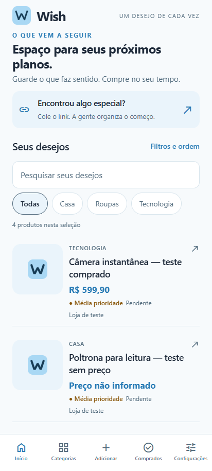
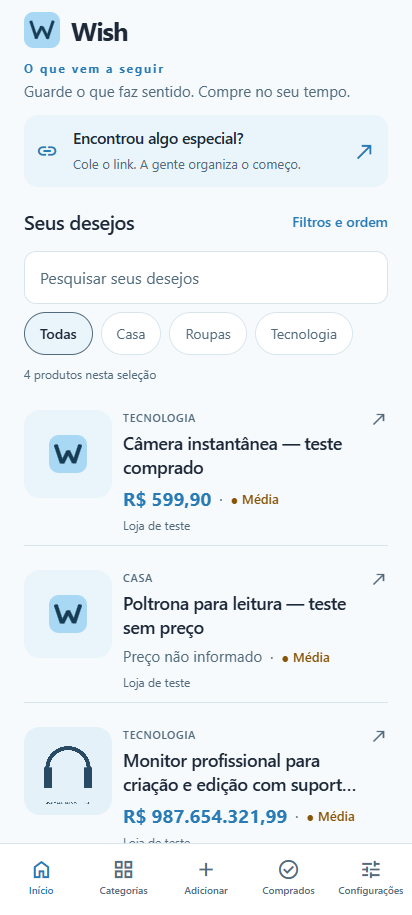
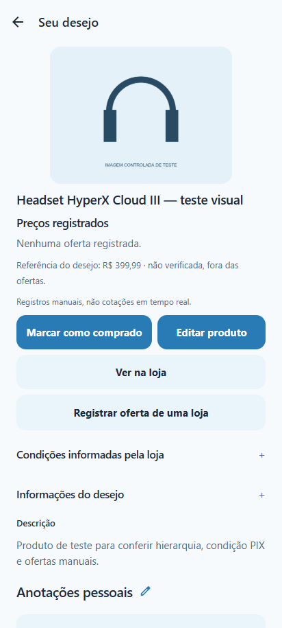
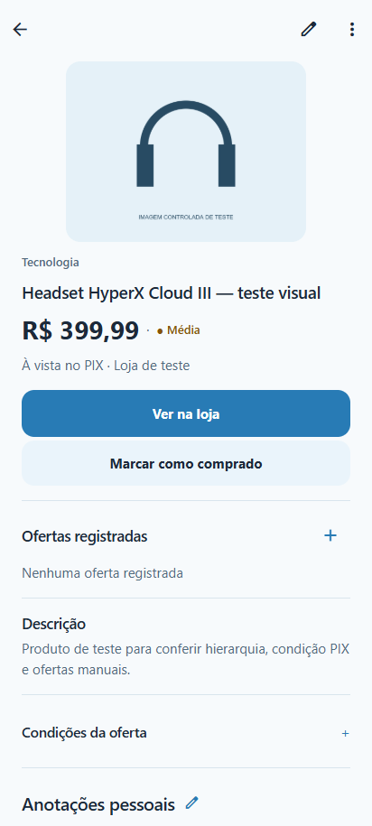
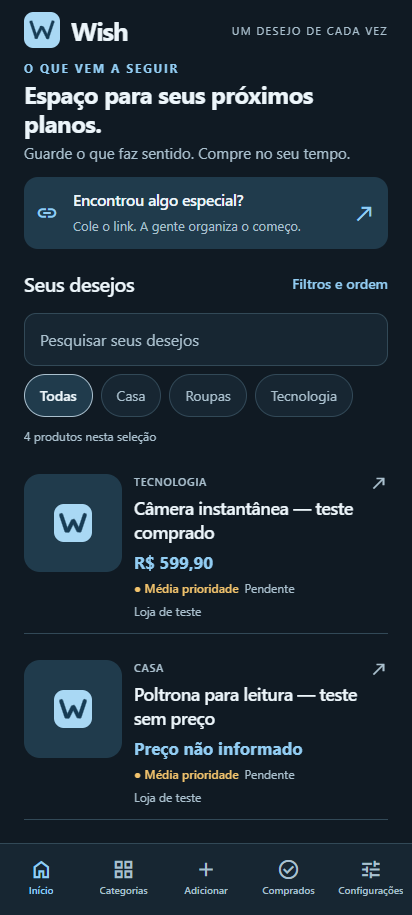
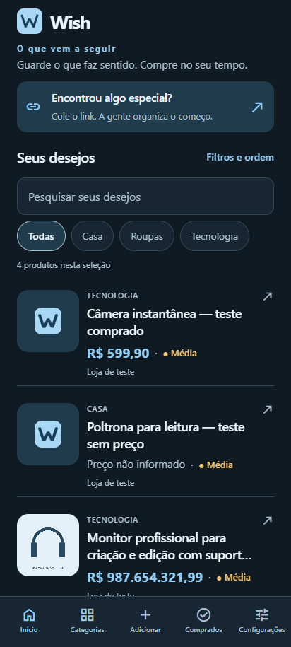
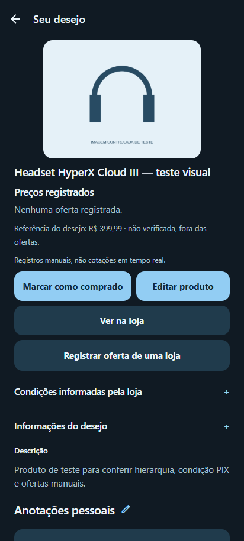
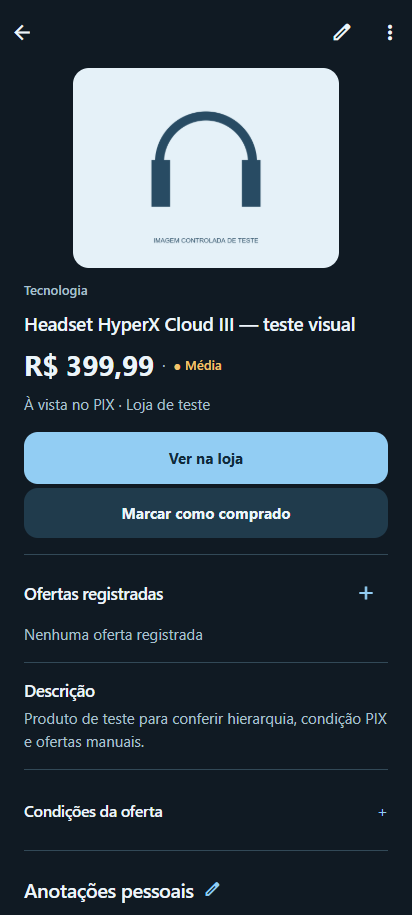

# Capturas reais — Fase 6.5

[Galeria local interativa](index.html) · [Relatório](../PHASE-6-5-UI-REFINEMENT.md)

Catálogo sintético e isolado, executado no Expo Web. Os preços não são cotações reais. Antes: 5a95361. Depois: código implementado nesta fase. Não equivale a aprovação Android.

## Comparações equivalentes

| Tela | Antes | Depois |
| --- | --- | --- |
| Início (light) |  |  |
| Detalhes PIX sem ofertas (light) |  |  |
| Início (dark) |  |  |
| Detalhes PIX sem ofertas (dark) |  |  |

## Todas as capturas implementadas

| Tela e cenário | PNG integral |
| --- | --- |
| Menu de ações secundárias (escuro) | [dark-actions.png](screenshots/after/dark-actions.png) |
| Adicionar (escuro) | [dark-add.png](screenshots/after/dark-add.png) |
| Categorias (escuro) | [dark-categories.png](screenshots/after/dark-categories.png) |
| Detalhes com PIX, sem ofertas — comparação equivalente (escuro) | [dark-comparison-details-pix.png](screenshots/after/dark-comparison-details-pix.png) |
| Descrição integral expandida (escuro) | [dark-description-expanded.png](screenshots/after/dark-description-expanded.png) |
| Detalhes com nome e descrição extensos (escuro) | [dark-details-long.png](screenshots/after/dark-details-long.png) |
| Sem preço, imagem ou descrição (escuro) | [dark-details-missing.png](screenshots/after/dark-details-missing.png) |
| Ofertas comuns e condicionais registradas (escuro) | [dark-details-offers.png](screenshots/after/dark-details-offers.png) |
| Detalhes com PIX e ofertas (escuro) | [dark-details-pix.png](screenshots/after/dark-details-pix.png) |
| Edição do desejo (escuro) | [dark-edit.png](screenshots/after/dark-edit.png) |
| Início com produtos (escuro) | [dark-home.png](screenshots/after/dark-home.png) |
| Prévia de importação (escuro) | [dark-import.png](screenshots/after/dark-import.png) |
| Card com nome/preço extensos · 320 px · CSS 26 px (escuro) | [dark-narrow-scaled-card.png](screenshots/after/dark-narrow-scaled-card.png) |
| Edição de anotações (escuro) | [dark-notes-editor.png](screenshots/after/dark-notes-editor.png) |
| Cadastro de oferta (escuro) | [dark-offer-editor.png](screenshots/after/dark-offer-editor.png) |
| Comprados vazio (escuro) | [dark-purchased-empty.png](screenshots/after/dark-purchased-empty.png) |
| Comprados preenchido (escuro) | [dark-purchased.png](screenshots/after/dark-purchased.png) |
| Configurações e aparência (escuro) | [dark-settings.png](screenshots/after/dark-settings.png) |
| Menu de ações secundárias (claro) | [light-actions.png](screenshots/after/light-actions.png) |
| Adicionar (claro) | [light-add.png](screenshots/after/light-add.png) |
| Categorias (claro) | [light-categories.png](screenshots/after/light-categories.png) |
| Detalhes com PIX, sem ofertas — comparação equivalente (claro) | [light-comparison-details-pix.png](screenshots/after/light-comparison-details-pix.png) |
| Descrição integral expandida (claro) | [light-description-expanded.png](screenshots/after/light-description-expanded.png) |
| Detalhes com nome e descrição extensos (claro) | [light-details-long.png](screenshots/after/light-details-long.png) |
| Sem preço, imagem ou descrição (claro) | [light-details-missing.png](screenshots/after/light-details-missing.png) |
| Ofertas comuns e condicionais registradas (claro) | [light-details-offers.png](screenshots/after/light-details-offers.png) |
| Detalhes com PIX e ofertas (claro) | [light-details-pix.png](screenshots/after/light-details-pix.png) |
| Edição do desejo (claro) | [light-edit.png](screenshots/after/light-edit.png) |
| Início com produtos (claro) | [light-home.png](screenshots/after/light-home.png) |
| Prévia de importação (claro) | [light-import.png](screenshots/after/light-import.png) |
| Card com nome/preço extensos · 320 px · CSS 26 px (claro) | [light-narrow-scaled-card.png](screenshots/after/light-narrow-scaled-card.png) |
| Edição de anotações (claro) | [light-notes-editor.png](screenshots/after/light-notes-editor.png) |
| Cadastro de oferta (claro) | [light-offer-editor.png](screenshots/after/light-offer-editor.png) |
| Comprados vazio (claro) | [light-purchased-empty.png](screenshots/after/light-purchased-empty.png) |
| Comprados preenchido (claro) | [light-purchased.png](screenshots/after/light-purchased.png) |
| Configurações e aparência (claro) | [light-settings.png](screenshots/after/light-settings.png) |
| Detalhes · 320 px · CSS 26 px (responsivo) | [narrow-scaled-details.png](screenshots/after/narrow-scaled-details.png) |
| Início · 320 px · CSS 26 px (responsivo) | [narrow-scaled-home.png](screenshots/after/narrow-scaled-home.png) |
| Aparência · 320 px · CSS 26 px (responsivo) | [narrow-scaled-settings.png](screenshots/after/narrow-scaled-settings.png) |
| Início · 1024 px (responsivo) | [wide-home.png](screenshots/after/wide-home.png) |

Fonte CSS 26 px não é fontScale Android. A simulação global evidencia corte de rótulos na barra inferior preexistente, preservada por escopo. Os novos segmentos responsivos não sobrepõem rótulos. Validar fontes nativas, TalkBack, teclado e gestos fisicamente.
