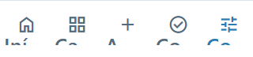
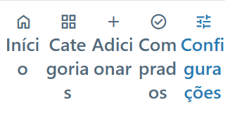
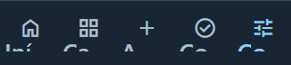
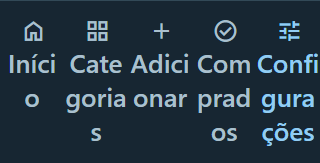

# Barra inferior — encerramento visual da Fase 6.5

Capturas reais do Expo Web, sem dados pessoais. [Relatório](../../PHASE-6-5-NAVIGATION-LABELS.md) · [Galeria local](index.html). CSS não equivale a fontScale físico Android.

## Fonte ampliada global em 320 px

| Tema | Antes | Depois |
| --- | --- | --- |
| Claro |  |  |
| Escuro |  |  |

## Normal preservado

Doze comparações em seis larguras e dois temas: arquivos PNG antes/depois idênticos, com barra de 72 px. [Comparações e hashes](normal-comparison.json). A linha única/reticências normais preexistentes foram preservadas; o nome acessível completo é explícito.

## Capturas integrais e outras escalas

| Etapa/cenário | Imagem |
| --- | --- |
| before | [dark-1024-normal-bar.png](before/dark-1024-normal-bar.png) |
| before | [dark-320-global26-bar.png](before/dark-320-global26-bar.png) |
| before | [dark-320-global26.png](before/dark-320-global26.png) |
| before | [dark-320-normal-bar.png](before/dark-320-normal-bar.png) |
| before | [dark-360-normal-bar.png](before/dark-360-normal-bar.png) |
| before | [dark-412-normal-bar.png](before/dark-412-normal-bar.png) |
| before | [dark-640-normal-bar.png](before/dark-640-normal-bar.png) |
| before | [dark-768-normal-bar.png](before/dark-768-normal-bar.png) |
| before | [light-1024-normal-bar.png](before/light-1024-normal-bar.png) |
| before | [light-320-global26-bar.png](before/light-320-global26-bar.png) |
| before | [light-320-global26.png](before/light-320-global26.png) |
| before | [light-320-normal-bar.png](before/light-320-normal-bar.png) |
| before | [light-360-normal-bar.png](before/light-360-normal-bar.png) |
| before | [light-412-normal-bar.png](before/light-412-normal-bar.png) |
| before | [light-640-normal-bar.png](before/light-640-normal-bar.png) |
| before | [light-768-normal-bar.png](before/light-768-normal-bar.png) |
| after | [dark-1024-normal-bar.png](after/dark-1024-normal-bar.png) |
| after | [dark-320-global26-bar.png](after/dark-320-global26-bar.png) |
| after | [dark-320-global26.png](after/dark-320-global26.png) |
| after | [dark-320-normal-bar.png](after/dark-320-normal-bar.png) |
| after | [dark-360-normal-bar.png](after/dark-360-normal-bar.png) |
| after | [dark-412-normal-bar.png](after/dark-412-normal-bar.png) |
| after | [dark-640-normal-bar.png](after/dark-640-normal-bar.png) |
| after | [dark-768-normal-bar.png](after/dark-768-normal-bar.png) |
| after | [light-1024-normal-bar.png](after/light-1024-normal-bar.png) |
| after | [light-320-global26-bar.png](after/light-320-global26-bar.png) |
| after | [light-320-global26.png](after/light-320-global26.png) |
| after | [light-320-normal-bar.png](after/light-320-normal-bar.png) |
| after | [light-360-normal-bar.png](after/light-360-normal-bar.png) |
| after | [light-412-normal-bar.png](after/light-412-normal-bar.png) |
| after | [light-640-normal-bar.png](after/light-640-normal-bar.png) |
| after | [light-768-normal-bar.png](after/light-768-normal-bar.png) |
| examples | [tab-label-dark-320-scale1.6.png](examples/tab-label-dark-320-scale1.6.png) |
| examples | [tab-label-dark-412-scale2.6.png](examples/tab-label-dark-412-scale2.6.png) |
| examples | [tab-label-dark-640-scale3.2.png](examples/tab-label-dark-640-scale3.2.png) |
| examples | [tab-label-light-320-scale1.6.png](examples/tab-label-light-320-scale1.6.png) |
| examples | [tab-label-light-412-scale2.6.png](examples/tab-label-light-412-scale2.6.png) |
| examples | [tab-label-light-640-scale3.2.png](examples/tab-label-light-640-scale3.2.png) |

[Matriz de 72 casos](matrix.json): 320/360/412/640 paisagem/768/1024, escalas CSS 1/1,3/1,6/2/2,6/3,2, claro/escuro. Falta validação nativa de fontScale/TalkBack/áreas seguras e teclado; nenhuma APK foi gerada.
